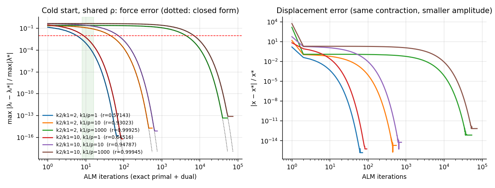
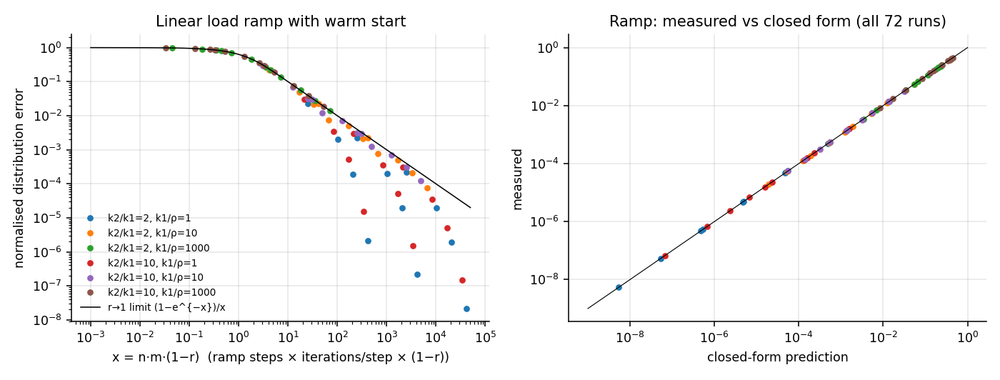
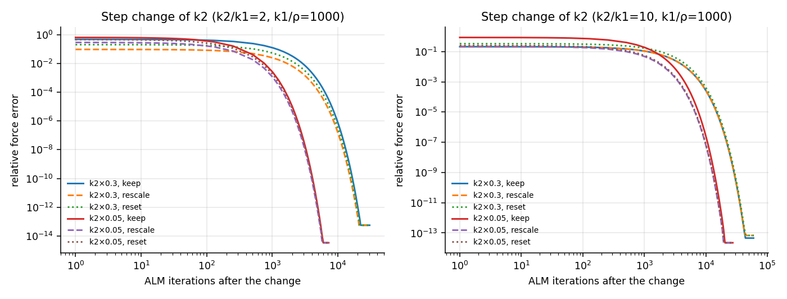
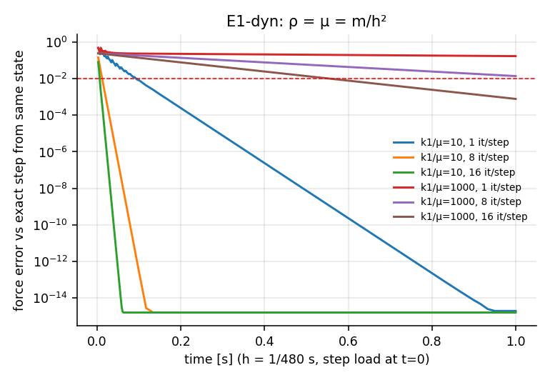

# E1 — Parallel springs, compliant ALM (analytic)

**Run:** `cargo run --release --bin e1` → `results/E1/` (summary.json carries the source hash, law version and schedule); figures: `python3 analysis/plot_e1.py`.
**Schedule:** exact scalar primal minimisation with λ frozen, then one simultaneous dual update $\lambda_i^+=s_i(\lambda_i+\rho_ix^+)$.
**Config:** $P=10^3$ N, $\rho_0=10^6$ N/m, $k_2/k_1\in\{2,10\}$, $k_1/\rho\in\{1,10,10^3\}$. *Assumption (recorded):* the spec's "$k_i/\rho$" levels are applied to $k_1$, with $k_2=$ ratio·$k_1$.

## 1. Validation (implementation = closed form)

| check | result |
|---|---|
| $r=(s_1w_2+s_2w_1)/(w_1+w_2)$ vs eigenvalue of $M=S-ws^\top/W$, 200 random $(\rho_1/k_1,\rho_2/k_2)\in[10^{-4},10^2]^2$ | max rel. dev. $5\times10^{-16}$ |
| shared-ρ form $2/(2+\rho/k_1+\rho/k_2)$ | identical to $r$ |
| per-iteration error vs $e_n=r^n(\ell^\top e_0)\,u$, every regime and config, while predicted error $>10^{-6}\max\lvert\lambda^*\rvert$ | max rel. dev. $1.9\times10^{-8}$ |
| ramp closed form $\lvert d_n\rvert=\lvert\delta\rvert\,r^m(1-r^{mn})/(1-r^m)$, 72 runs | max rel. dev. $1.6\times10^{-8}$ |
| $\sum\lambda=P$ after every update | to round-off |
| round-off plateau of the force error | $\le\varepsilon_{64}/(1-r)$ in all configs, e.g. $4.6\times10^{-14}$ at $r=0.99925$ |

The deviation is limited by accumulated round-off, which a slowly contracting iteration amplifies by $\approx1/(1-r)$. The f64 implementation reproduces the analytic contraction within this explicitly stated tolerance.

## 2. Results

**Cold start, shared ρ** (relative force error $\max_i\lvert\lambda_i-\lambda_i^*\rvert/\max\lvert\lambda^*\rvert$):

| $k_2/k_1$ | $k_1/\rho$ | $r$ | err @ 8 it | err @ 16 it | iterations to 1 % | split after 1st update (exact) |
|---|---|---|---|---|---|---|
| 2 | 1 | 0.5714 | 0.3 % | <0.01 % | 6 | 0.43 : 0.57 (0.33 : 0.67) |
| 2 | 10 | 0.9302 | 14 % | 7.9 % | 45 | 0.49 : 0.51 |
| 2 | 1000 | 0.99925 | 25 % | 25 % | 4 350 | 0.500 : 0.500 |
| 10 | 1 | 0.6452 | 1.4 % | <0.01 % | 9 | 0.35 : 0.65 (0.09 : 0.91) |
| 10 | 10 | 0.9479 | 29 % | 19 % | 72 | 0.48 : 0.52 |
| 10 | 1000 | 0.99945 | 45 % | 45 % | 6 936 | 0.500 : 0.500 |

- **Force balance is satisfied after one update and says nothing about convergence.** After one update the whole error lies along $u=(1,-1)$, and only the distribution between the springs remains wrong.
- **Displacement is not a safe proxy.** Its relative error decays at the same $r$ with amplitude $\approx\frac{k_2^2-k_1^2}{2k_1k_2}\times$ distribution error, independent of ρ for $k\gg\rho$: 12 % ($k_2/k_1=2$) and 200 % ($k_2/k_1=10$) after 8 iterations. The complementary energy $\sum\lambda^2/2k$ errs by 12 % and 200 %, the displacement energy by 26 % and 810 %. This corrects a remark in the design note **[rev]**.
- **Step change in P:** identical contraction; at $k_1/\rho=10^3$, 8–16 iterations remove nothing measurable (12–45 % error remains).
- **Slow ramp with warm start:** the error depends only on $x=n\,m(1-r)$, total iterations measured in units of $1/(1-r)$, and follows $(1-e^{-x})/x$ for $r\to1$. At 60 Hz, 8 it/step and $k_1/\rho=10^3$: 21 % after a 1 s ramp, 6.7 % after 10 s, 0.7 % after 100 s.

- **Step change in $k_2$ (damage stand-in), multiplier policies** at $k_1/\rho=10^3$ (relative force error after the first update):

| $k_2/k_1$ | $k_2$ factor | keep λ | rescale $\lambda_2\cdot k_2'/k_2$ | reset λ = 0 |
|---|---|---|---|---|
| 2 | 0.3 | 47 % | **9 %** | 20 % |
| 2 | 0.05 | 63 % | **28 %** | 45 % |
| 10 | 0.3 | 21 % | 21 % | 33 % |
| 10 | 0.05 | 86 % | **22 %** | 25 % |

  Strain-consistent rescaling is never worse here and usually best; keeping force-continuous multipliers is usually worst. All three then decay at the new $r'$ (≈0.999), so none of them reaches 1 % within a budget. This is the recommended declared policy for stiffness changes in S1 (used from E2 on).

- **Per-spring $\rho_i=c\,k_i$:** $r=1/(1+c)$ exactly, independent of the stiffness ratio. 1 % within 8 iterations needs $c\gtrsim0.6$, i.e. ρ comparable to the physical stiffness. Mixed policies follow the general formula (validated above).
- **S2 in E1:** exact after one 1×1 factorization. Dual injection (coupling B) puts S1 at its fixed point in one step. As predicted, this carries **no** information about S2 cost or consistency.
- **E1-dyn** (labelled extension; $\rho=\mu=m/h^2$, $h=1/480$ s, step load from rest): with $k_1/\mu=10$ the error vanishes within 0.1 s for 8–16 it/step. With $k_1/\mu=10^3$ ($k\Delta t^2/m\approx(c\Delta t/\ell)^2$, i.e. concrete cells of ≈0.23 m at this $\Delta t$; 0.5 m cells give ≈220) the one-step force error is still 6 % (8 it) or 1.4 % (16 it) after **0.5 s** of a static load. The spectral radius of the dynamic iteration matrix stays ≈ $r$: inertia does not rescue force distribution.

## 3. Interpretation and limits

1. The counterexample is reproduced exactly. For the examined shared-ρ schedule the force-distribution error contracts at $r\approx1-\tfrac12(\rho/k_1+\rho/k_2)$, so $k\gg\rho$ means thousands of iterations. **This disproves a general fast-force-convergence claim for this iteration only.**
2. In E1 the fix is trivial: $\rho_i\gtrsim k_i$ gives $r\le\tfrac12$. That is only because E1's primal is a scalar solved exactly. Large ρ puts the physical stiffness back into the primal problem, whose conditioning E1 cannot see. **E1 cannot decide the S1/S2 fork.** E2/E3 measure the primal side on real multi-DOF structures.
3. Not shown by E1: that every local solver fails in 8–16 sweeps, that S2 is mandatory, or anything about S2's cost and coupling.
4. Q5 note: in a slowly contracting fixed-point iteration a per-iteration perturbation $q$ (round-off now, the λ quantum in fixed point later) leaves a steady error $\approx q/(1-r)$. At $r=0.99925$ that is ~10 bits lost. Multiplier formats must be sized with this gain.

**Decision-map implication:** none yet. E1 shows the shared-ρ ALM iteration needs ρ ≈ k for force accuracy within budget. Whether any ρ satisfies both primal and dual within 8–16 sweeps is E2's question.
