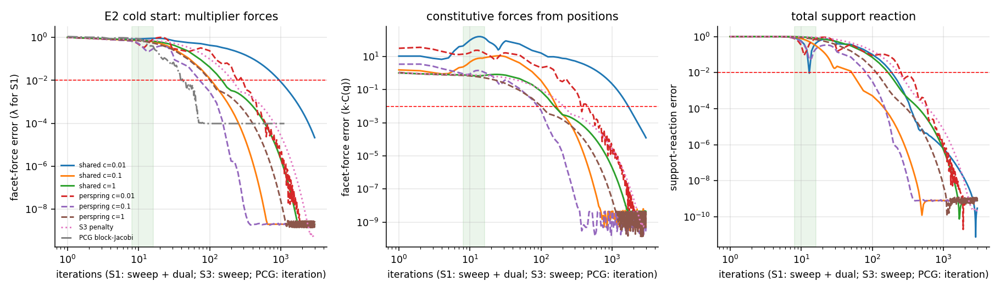
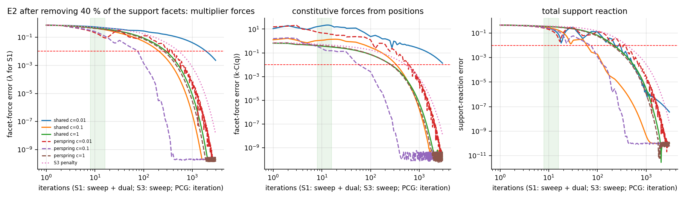

# E2 — Redundant RBSN block: force truth vs work

**Run:** `cargo run --release --bin e2` (≈50 s) → `results/E2/`; figures `python3 analysis/plot_e2.py`.
**Setup:** 1.0 m × 0.5 m block, $b=0.1$ m, $d_{\min}=0.05$ m (145–146 cells, ≈400 facets, 5–6 colours), 3 tessellations. Bottom edge clamped through ground facets (n + t). Eccentric top patch load on the left 40 % of the top edge: −2 MPa normal and +0.5 MPa shear (statically indeterminate). Elastic reference concrete. Quasi-static: no inertia, so every ρ is a stiffness-normalised penalty (shared: $\rho=c\,\bar k_n$; per-spring: $\rho_c=c\,k_c$).
**Schedule:** S1 iteration = colour-sequential primal sweep (one Gauss–Newton block step per cell, 3×3) + simultaneous dual update. S3 = same sweep with physical stiffness (no multipliers). PCG = block-Jacobi preconditioned CG on the reference-frame linear $K$. S2 = $Ku=f$ (linear, reference frame).
**Error metric:** relative L2 of facet resultants (N, V, M; max over the three) against S0 (nonlinear corotated Newton). S1 is reported with multiplier forces (λ) and constitutive forces $kC(q)$ separately.

## Cold start (seed 1; ranges across 3 tessellations)

| method | force err @ 8 it (λ / kC) | @ 16 it (λ / kC) | iterations to 1 % (3 seeds) |
|---|---|---|---|
| shared $c=10^{-3}$ | 0.89 / 579 | 1.06 / 1707 | >3000 |
| shared $c=10^{-2}$ | 0.83 / 44 | 0.91 / 135 | 975–1625 |
| shared $c=0.1$ | 0.75 / 2.4 | 0.63 / 8.6 | 125–175 |
| shared $c=1$ | 0.78 / 0.78 | 0.68 / 0.73 | 150–225 |
| shared $c=10$ | 0.80 / 0.80 | 0.72 / 0.70 | 200–350 |
| per-spring $c=10^{-2}$ | 0.68 / 14 | 0.82 / 16 | 250–325 |
| **per-spring $c=0.1$** | 0.68 / 0.92 | **0.30** / 1.1 | **75–100** |
| per-spring $c=1$ | 0.75 / 0.73 | 0.55 / 0.52 | 125–200 |
| S3 (penalty) | 0.81 | 0.72 | 225–375 |
| PCG block-Jacobi | 0.90 | 0.39 | **43–53** |
| S2 (one factorization) | — | — | exact up to the linearisation ($10^{-4}$) |

- **The 1 % target in 8–16 sweeps is missed by every local method, by 1.5–2 orders of magnitude** (best 30 % at 16). Prediction P-E2 holds.
- The ALM trade-off from E1 appears in full. Small ρ: multipliers stay bounded, but positions and constitutive forces are wildly wrong (displacement 30×, $kC$ up to 1700× for $c=10^{-3}$) — ALM's primal is soft until λ builds up. Large ρ ($c\ge1$) behaves like S3, slow because of primal conditioning. The optimum ($c\approx0.1$, per-spring) is a balance that still needs ≈80 sweeps.
- Even the **total** support reaction is 77–99 % wrong after 8 sweeps: the load has not yet reached the supports (≈10 cells away). This is the domain-of-dependence effect, not a solver-tuning issue.

## Sudden change: 40 % of the support facets removed from a converged state

Initial error (warm λ and q, new S0 reference): 75 %.

| method | @ 8 | @ 16 | @ 100 | iterations to 1 % |
|---|---|---|---|---|
| shared $c=0.1$ | 49 % | 34 % | 5.0 % | 225 |
| per-spring $c=10^{-2}$ | 27 % (kC 560 %) | 8.8 % | 13 % | 325 |
| per-spring $c=0.1$ | 31 % | 12 % | 0.1 % | 100 |
| S3 | 54 % | 45 % | 17 % | 525 |

Warm start does not help much after a topological change: the error after 16 sweeps is still ~10–45 %. This is the regime that matters for destruction (support loss, fracture).

## Slow ramp, warm start (load factor 0 → 1)

| method | 60 steps × 8 | 60 × 16 | 600 × 8 | 600 × 16 |
|---|---|---|---|---|
| shared $c=0.01$ (λ) | 27 % | 15 % | 3.0 % | 1.5 % |
| shared $c=1$ | 6.0 % | 2.7 % | 0.60 % | 0.26 % |
| per-spring $c=1$ | 3.8 % | 1.6 % | 0.38 % | **0.16 %** |
| S3 | 8.2 % | 3.8 % | 0.82 % | 0.38 % |

Slowly varying loads (a 10 s ramp at 60 Hz) are tracked within 1 % by several policies. With small ρ the *total* reaction is right to 0.03 % while facet forces are 27 % wrong (E1: equilibrium is immediate, the distribution is not).

## S2 cost on this block

435 DOFs: nnz(L) = 9 117, ≈2.1·10⁵ flops per numeric factorization, ≈3.6·10⁴ flops per solve, against ≈1 600 point evaluations per S1 sweep. On a 2D block of this size **one factorization costs about one sweep** and gives the answer. The scaling is E3's question. S2 differs from S0 by $\approx10^{-4}$ (the linearisation of the corotated kinematics at strains of $10^{-4}$), reported as a model approximation, not as under-convergence. PCG plateaus at the same level for the same reason.

## Interpretation

- Q2, first answer: on a statically indeterminate block 10 cells high, **S1 with any tested ρ policy and S3 do not deliver force truth within 8–16 sweeps after a cold start or a support loss**. They do under slow loading with warm start. The best local policy needs ~80–100 sweeps. A global method is far ahead: PCG with ~45 iterations, though with global reductions; a direct factorization costs ≈ one sweep here.
- Multiplier forces and constitutive forces from positions disagree massively before convergence. A fracture criterion fed by either one in an unconverged state would be fed garbage. The constitutive residual must be monitored if S1 is used.
- Decision map: "S1 meets targets with some ρ policy" — **not** for cold and sudden-change regimes. E3 sizes the gap with $N$ and the dynamic regime.
