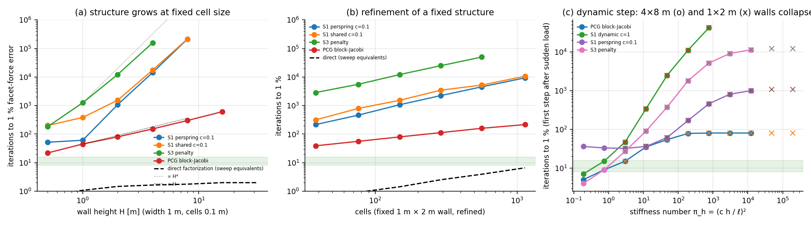
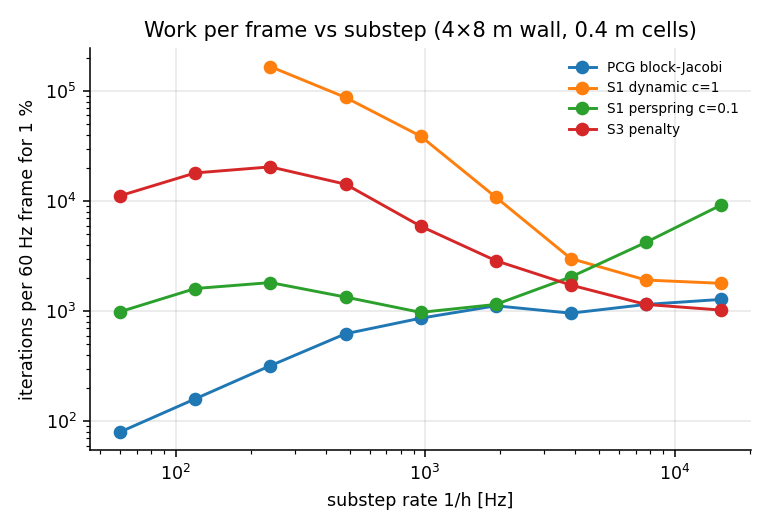

# E3 — Scaling: work required for force truth

**Run:** `cargo run --release --bin e3` (≈1.5 h, dominated by the slow local methods) → `results/E3/`; figures `python3 analysis/plot_e3.py`. It was re-run after the final kinematics change (support-frame corotation, E6/E7); all 118 iteration counts are identical.
**Setup:** clamped wall, width 1 m, $b=0.2$ m, top traction $(+2.5, -10)$ kPa, elastic concrete. Loads are kept small so that geometric nonlinearity stays ≲$10^{-4}$ and the linear PCG/S2 and corotated S0/S1 solve effectively the same equations. *(A first run at 100× the load showed PCG stagnating above 1 % at 8 m height: P-Δ effects made the "same equations" assumption false. Recorded and corrected.)*
**Metric:** iterations until the L2 facet-force error ≤ 1 % against S0 (cold start; checked at ~2 % resolution). Methods: S1 per-spring $\rho=0.1k$ (best in E2), S1 shared $\rho=0.1\bar k$, S3 penalty, block-Jacobi PCG; direct factorization cost from nnz(L) and flops.

## (a) The structure grows at fixed cell size (cells 0.1 m, height $H$)

| $H$ [m] | cells | S1 per-spring | S1 shared | S3 | PCG | direct: nnz(L) | factor flops |
|---|---|---|---|---|---|---|---|
| 0.5 | 41 | 52 | 201 | 184 | 22 | 1 800 | 2.8·10⁴ |
| 1 | 76 | 61 | 384 | 1 254 | 45 | 4 185 | 8.5·10⁴ |
| 2 | 149 | 1 072 | 1 536 | 12 224 | 80 | 9 648 | 2.4·10⁵ |
| 4 | 290 | 14 272 | 17 408 | 157 056 | 152 | 20 178 | 5.2·10⁵ |
| 8 | 571 | 213 312 | 215 936 | >300 000 | 300 | 41 409 | 1.1·10⁶ |
| 16 | 1 162 | — | — | — | 612 | 89 208 | 2.6·10⁶ |
| 32 | 2 253 | — | — | — | (10 % at 1 320) | 172 890 | 5.0·10⁶ |

- **Local methods scale ≈ $H^4$** (×13–15 per doubling once the wall is slender). **[rev]** The pre-registered prediction said ≈ $N^2$. That holds for second-order (membrane/shear) problems; a slender structure under lateral load is governed by **bending, a fourth-order operator**, whose condition number grows as $(L/h)^4$. Destructible game structures (columns, beams, walls, towers) are exactly this case.
- PCG scales ≈ $H$; direct factorization is linear in $N$ for a strip (bandwidth fixed). At $H=8$ m one factorization costs ≈ 2 sweeps and a solve ≈ 0.3 sweeps (at an assumed ~100 flops per point evaluation), versus 2·10⁵ sweeps for the best local method.

## (b) Fixed 1 m × 2 m wall, refined

| $d_{\min}$ [m] | cells | S1 per-spring | S3 | PCG | factor flops |
|---|---|---|---|---|---|
| 0.2 | 38 | 216 | 2 860 | 39 | 2.4·10⁴ |
| 0.1 | 149 | 1 072 | 12 224 | 80 | 2.4·10⁵ |
| 0.05 | 564 | 4 544 | 50 368 | 160 | 2.4·10⁶ |
| 0.035 | 1 136 | 9 344 | >60 000 | 216 | 8.3·10⁶ |

Per-spring S1 grows ∝ cells (∝ (cells across)²), S3 faster, PCG ∝ cells across. Direct factorization flops grow ∝ cells^1.7 (2D fill-in). Refinement is far less punishing than slenderness.

## (c) Dynamics (E3-dyn): first implicit-Euler step after a sudden load

Two geometrically similar walls (4×8 m with 0.4 m cells, 1×2 m with 0.1 m cells, identical topology). **Their iteration counts coincide at equal $\pi_h=(c\,h/\ell)^2$** (e.g. 168 sweeps at $\pi_h=190$ for both): the stiffness number, not $h$ or $\ell$ separately, governs the solver cost.

| $\pi_h$ | game example (0.4 m cells) | S1 dynamic ρ = $m_{\rm eff}/h^2$ | S1 per-spring 0.1k | S3 | PCG |
|---|---|---|---|---|---|
| 12 144 | 1/60 s | >10⁵ | 990 | 11 200 | 80 |
| 759 | 1/240 s | 41 664 | 455 | 5 120 | 80 |
| **190** | **1/480 s** | 10 944 | **168** | 1 782 | 78 |
| 47 | 1/960 s | 2 432 | 61 | 370 | 54 |
| 12 | 1/1920 s | 340 | 36 | 90 | 35 |
| 3.0 | 1/3840 s | 47 | 32 | 27 | 15 |
| 0.74 | 1/7680 s | 15 | 33 | 9 | 9 |
| 0.19 | 1/15360 s | **7** | 36 | **4** | 5 |

Per 60 Hz frame, the best local method needs **≈1 000–1 300 sweeps for 1 % at every substep size** ($\pi_h$ from 190 down to 0.2). S3's work per frame falls monotonically as $h$ shrinks (14 256 at 1/480 → 1 020 at 1/15360), confirming P-E3-dyn: Gauss–Seidel cost per step ∝ $\pi_h$, so per frame ∝ $h$. The ALM note's recommended $\rho\approx m_{\rm eff}/h^2$ is the *worst* policy when $\pi_h\gg1$ (E1 mechanism: $\rho\ll k$) and the best only when $\pi_h<1$, i.e. the explicit-like regime $h\lesssim\ell/c$.

## Interpretation (Q2, decision map)

- **"S1 meets targets with some ρ policy": rejected** for cold and sudden-change regimes at any realistic size. E2 found a 10× gap at 145 cells; here it grows with $N^4$ for slender structures. Within 8–16 sweeps, 1 % is reached only for $\pi_h\lesssim1$, i.e. $h\lesssim\ell/c$: 125 µs for 0.5 m concrete cells, ~130 substeps per frame at one sweep each. That is the wave-resolved regime context §2.1 had excluded on cost.
- A static global solve (S2) has the right complexity class here: cost linear in $N$ for strips, about one sweep per factorization at these sizes. PCG is the other global option (~N iterations, each with global reductions).
- The real-time budget question is therefore not "which ρ" but **"global solve vs. wave-resolved local stepping vs. hierarchy"**. This result feeds the Track-B device measurements (sparse triangular-solve depth vs. dispatch count).
- Caveats: CPU work counts, not GPU time; no multigrid or aggregation hierarchy was tried (the decision map's third branch); the cold-start, first-step-after-sudden-load case is the worst case (E2's slow ramps are benign).
