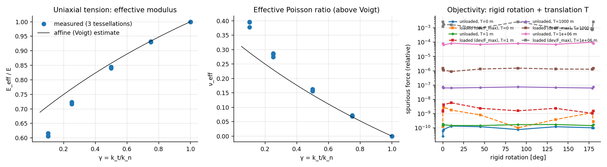

# E4 — Elastic patch tests

**Run:** `cargo run --release --bin e4` (≈2 min) → `results/E4/`; figure `python3 analysis/plot_e4.py`.
**Setup:** 1 m × 1 m block, $b=0.1$ m, RSA $d_{\min}=0.05$–0.06 m (≈220–300 cells), 3 tessellations (seeds 1–3), reference concrete, elastic law, two-point corotated facets, S0 Newton with sparse Cholesky.

## Results

**(a) Uniform strain, exactness.** $\varepsilon=\begin{psmallmatrix}1&0.4\\0.4&-0.6\end{psmallmatrix}\times10^{-4}$; boundary cells prescribed, interior solved.

| drive of boundary cells | γ | max facet-traction deviation from $E\varepsilon n$ (interior) | interior DOF error |
|---|---|---|---|
| rigid motion following the **generator** | 1 | $1.7$–$1.8\times10^{-11}$ | $\sim10^{-12}$ |
| naive: field evaluated at the **centroid** | 1 | 6–8 % | 1–1.5 % |
| generator | 0.5 | 56–59 % (local) | 2.7–3.0 % |

The uniformity result (Bolander–Saito) holds exactly with $k_t=k_n$, *provided* the generator→centroid transform is explicit. Substituting centroid positions breaks it at the predicted order $\lVert g-X\rVert/\ell$. Context §6.2's warning is confirmed numerically. The residual $\approx5\times10^{-11}$ of the force scale is the f64 round-off floor of absolute coordinates, $\varepsilon_{64}\,k\,L$.

**(b) Uniaxial tension** (roller walls, one y gauge):

| γ | $E_{\rm eff}/E$ | Voigt | $\nu_{\rm eff}$ | Voigt $(1-\gamma)/(3+\gamma)$ | CoV of cell $\sigma_{xx}$ |
|---|---|---|---|---|---|
| 1 | 1.000000000 | 1 | $<10^{-15}$ | 0 | $2.6\times10^{-12}$ |
| 0.75 | 0.930–0.932 | 0.933 | 0.069–0.072 | 0.067 | 1.6–1.8 % |
| 0.5 | 0.840–0.845 | 0.857 | 0.156–0.163 | 0.143 | 4.1–4.5 % |
| 0.25 | 0.716–0.724 | 0.769 | 0.275–0.288 | 0.231 | 8.8–9.5 % |
| 0.1 | 0.606–0.616 | 0.710 | 0.378–0.397 | 0.290 | 15 % |

- γ = 1 reproduces $E$ exactly and gives $\nu=0$ for every tessellation (as stated in context §6.2: $\nu=0$ is the price of uniformity).
- For γ < 1, stress becomes non-uniform (tessellation noise grows as γ decreases) and $E_{\rm eff}$ falls below the affine estimate, as expected. **[rev]** $\nu_{\rm eff}$ lies *above* the affine estimate; the design note predicted lower. Nonzero ν with this lattice therefore trades uniformity for noise. A Poisson treatment (e.g. Bolander's iterative scheme) remains a separate task.

**(c) Rigid motion without solve** (max over rotations 0–180°):

| translation $T$ | unloaded: spurious force / point failure force | loaded: force deviation / $F_{\max}$ |
|---|---|---|
| 0 | $1.3\times10^{-10}$ | $2\times10^{-9}$ |
| 1 m | $1.9\times10^{-10}$ | $6\times10^{-9}$ |
| $10^3$ m | $7\times10^{-8}$ | $2.6\times10^{-6}$ |
| $10^6$ m | $1\times10^{-4}$ | $2.7\times10^{-3}$ |

Objectivity is exact in arithmetic; what remains is round-off of **absolute** positions and grows ∝ $T\,\varepsilon_{64}$. At $10^6$ m, f64 absolute coordinates lose ~20 bits against the ~50 µm failure-stretch scale. This is the quantitative case for the context's base+delta position design (§4), which evaluates jumps in a local frame.

**(d) Incremental rotation with Newton** (left plate clamped, right plate roller; 10 cycles 0→180°→0 in 1° steps = 3600 solves): unloaded, max spurious force $6\times10^{-9}$ of the point failure force; pre-stretched ($10^{-4}$), max deviation of facet forces from the unrotated state $2\times10^{-9}$. **No drift.** Newton needs ≈4 iterations per 1° increment with the Gauss–Newton tangent.

## Interpretation

- Q1 (elastic part): the generator-based RBSN reproduces uniform stress exactly, and the corotated two-point facet is objective to round-off under large rotations. Targets "uniform stress up to tessellation noise" and "spurious forces under rigid motion at round-off" are **met**.
- Two corrections came out of this stage, both recorded in the design note. Rigid-support facets must use $\ell_e=d$, not the mirror $2d$; that was caught while designing (b), where uniformity would otherwise fail at the boundary. The ν estimate also changed (above).
- Solver note: Newton needed a round-off-aware stopping rule. The residual floor of an absolute-coordinate formulation is $\varepsilon_{64}kL$, not an arbitrary tolerance. S0 reports `roundoff_limited` when it stops there.
