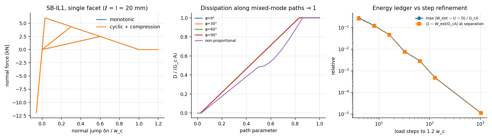
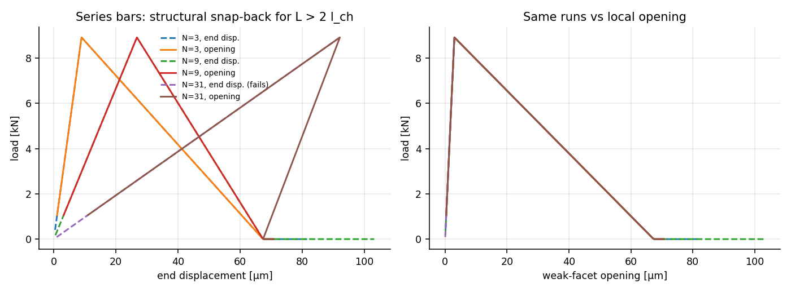

# E5 — Single facet and small specimens: SB-IL1 energy closure

**Run:** `cargo run --release --bin e5` (<1 s) → `results/E5/`; figures `python3 analysis/plot_e5.py`.
**Law:** SB-IL1 (docs/00 §3.3), two-point facet. Lab facet: $\ell_e=l=20$ mm, $b=0.1$ m, $A=2\cdot10^{-3}$ m², $G_cA=0.2$ J, $\delta_0=2\,\mu$m, $w_c=66.7\,\mu$m, $\ell_e/l_{ch}=0.06$.
**Procedure (a):** prescribed jump paths; per step evaluate, commit history, record the agent force. $W_{\rm ext}$ is the independent trapezoidal work of the agent force; $D$ is the law's closed-form dissipation of the committed history; ledger residual $\varepsilon=W_{\rm ext}-U-D$ (signed).
**Procedure (b):** series bars of $N$ square cells (30 mm), left clamped, right plate. One facet is 1 % weaker ($\sigma_t\times0.99$, same $G_c$) so localisation is deterministic. S0 bordered Newton with indirect control. A step is accepted if Newton converged and $\max\Delta d\le0.05$, otherwise halved; history is committed only on acceptance.

## Results

| test | $D/G_cA$ | other checks |
|---|---|---|
| monotonic to $1.2w_c$ | **1.000** (every refinement) | ledger residual 28 % (4 steps) → 12 % (8) → 0.8 % (32) → 0.05 % (128) → $10^{-5}$ (1024) |
| partial damage to $\kappa=\delta_0+f(w_c-\delta_0)$, $f=0.25/0.5/0.75$, then unload | **0.25 / 0.50 / 0.75** | after unloading $W-D\approx10^{-5}G_cA$: all elastic energy returned |
| cyclic 0→0.3$w_c$→0→0.6$w_c$→$-2\delta_0$→1.2$w_c$ | 1.000 | **no dissipation on any unloading step**; compression transmitted at full $k_n$ after closure |
| mixed mode, proportional at φ = 0°, 30°, 60°, 90° | 1.000 (all) | path independence of the law (§3.3) confirmed |
| mixed, non-proportional (shear 0.5$w_c$, then normal) | 1.000 | |
| game-scale facet $\ell_e=0.5$ m ($\ell_e/l_{ch}=1.5$) | 1.000 | admissible; softening slope parameter β = 0.25 (steep) |
| $\ell_e=0.7$ m ($\ell_e/l_{ch}=2.1$, inadmissible) with crack-band option η = 0.95 | 1.000 | $\sigma_{\rm eff}=0.927\sigma_t$, β = 0.098 (near-vertical drop); without the option the model refuses to build |

- The ledger residual comes only from trapezoidal quadrature of $W_{\rm ext}$ on steps that straddle a kink of the σ–δ curve (onset, full separation). It is negative (coarse steps cut the peak) and converges to zero under step refinement, as targeted ("dissipated energy → $G_clb$ as load steps refine"). It is a measurement error, not energy creation.

**Chains (structural snap-back):**

| $N$ | $L/2l_{ch}$ | end-displacement control | weak-facet opening control | damaged facets | $D/G_cA$ |
|---|---|---|---|---|---|
| 3 | 0.14 | completes | completes | 1 | 1.000 |
| 9 | 0.41 | completes | completes | 1 | 1.000 |
| 31 | 1.40 | **fails at the peak** (no equilibrium within the cut-back limit) | completes, traces the snap-back | 1 | 1.000 |

The local condition $\ell_{\rm cb}<2l_{ch}$ excludes only *local* snap-back. A structure whose stored elastic energy exceeds $G_cA$ snaps back globally (context §6.3: "this does not exclude structural snap-back"). Displacement control then cannot follow, and an opening/CMOD control (or arc-length) is required. In a dynamic game setting the snap-back branch is a dynamic release; E7 and E9 inherit this.

## Interpretation

- Targets met. Dissipated energy equals $G_clb$ exactly for the law and is approached by the independently measured work as steps refine. Unloading dissipates nothing, and partial damage dissipates in proportion to the history variable's progress through the softening range.
- The trial/commit contract works as specified: history is written only on acceptance, and rejected (cut-back) trials leave it unchanged. That is why 23 cut-backs per chain run do not distort the dissipation.
- What E5 does not show: behaviour on a random lattice, where macroscopic mode I loads facets in mixed modes with inclined facets. The law is path-independent by construction, so the open question in E6 is the *area* (tortuosity) and mesh objectivity, not the per-facet budget.
