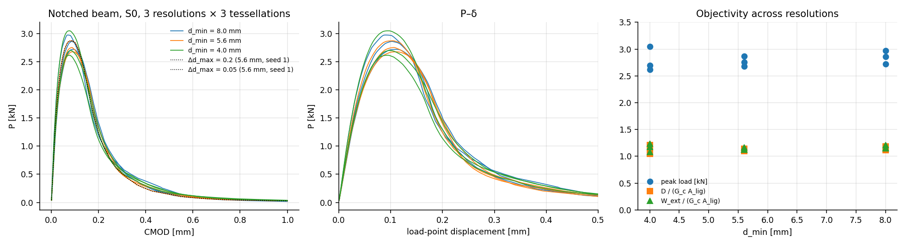
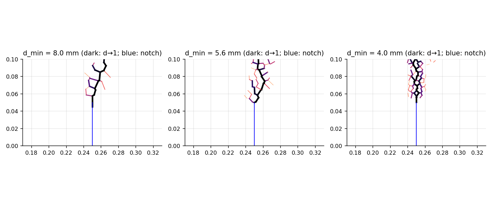
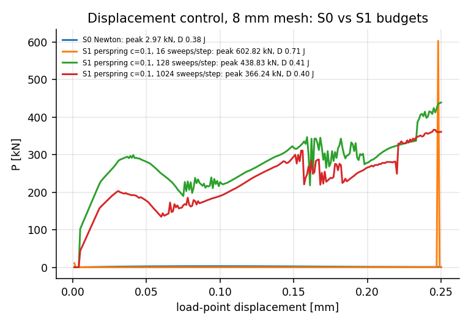

# E6 — Notched beam, three-point bending (lab scale)

**Run:** `cargo run --release --bin e6` (≈40 min) → `results/E6/` (`summary.json`, `s0_curves.csv`, `damage_run*.csv`, `final_q_run*.csv`, `disp_control.csv`); figures `python3 analysis/plot_e6.py`.
**Specimen:** 500 × 100 × 100 mm, span 400 mm, notch 50 mm (half depth), reference concrete ($l_{ch}=0.33$ m, $\ell_e/l_{ch}\le0.06$), crack-band option off. Mirrored seeds within $2d_{\min}$ of the notch plane below the tip, so the notch faces are exact Voronoi edges; the tessellation above is random. Resolutions $d_{\min}$ = 8, 5.6, 4 mm (≈550 / 1 090 / 2 130 cells) × 3 tessellations. Material parameters fixed across resolutions, no artificial heterogeneity.
**Boundary conditions (declared):**
- Both supports and the loading pad are normal-only unilateral contacts (zero tensile strength), measured in the support/plate frame.
- The plate moves in $y$ only.
- One cell $x$-DOF is the only horizontal constraint (a pure gauge, zero reaction).
- Damage is allowed only in the central zone $|x-x_c|<80$ mm (0.8 D).
**S0:** bordered Newton under CMOD control (consistent tangent, secant fallback). A step is accepted if converged and $\max\Delta d\le0.1$ over material facets, otherwise halved. History is committed on acceptance only. CMOD to 1.0 mm (load < 1.5 % of peak).

## Results

| $d_{\min}$ | peak load [kN] (3 tessellations) | mean ± sd | $D/(G_cA_{\rm lig})$ | mean | process zone (RMS half-width) |
|---|---|---|---|---|---|
| 8 mm | 2.97 / 2.72 / 2.86 | 2.85 ± 0.10 | 1.19 / 1.14 / 1.12 | 1.15 | 2.5–7.9 mm |
| 5.6 mm | 2.87 / 2.75 / 2.68 | 2.77 ± 0.08 | 1.11 / 1.14 / 1.09 | 1.11 | 2.9–7.0 mm |
| 4 mm | 2.70 / 3.05 / 2.62 | 2.79 ± 0.19 | 1.15 / 1.21 / 1.05 | 1.14 | 1.7–3.8 mm |

- **Mesh objectivity: met.** Mean peak load differs by ≤ 3 % between resolutions and dissipation by ≤ 3 %. The tessellation spread is ±4–7 %, against a target of 10–15 %.
- **Dissipation is 1.05–1.21 $G_cA_{\rm lig}$**, inside the pre-registered tortuosity range (1.1–1.3). With geometric-area normalisation each broken inclined facet dissipates $G_c\times$ its own area. Bolander–Berton's projected-area convention would remove this factor; it is the next law variant to compare, not adopted here.
- **Solver truth.**
  - Ledger residual $|W_{\rm ext}-U-D|\le6\times10^{-5}D$ on every run.
  - Event-size refinement $\Delta d_{\max}$ = 0.2 / 0.1 / 0.05 gives peak 2.871 / 2.872 / 2.872 kN and $D$ 1.108 / 1.108 / 1.108: step-converged.
  - No step failed; the secant fallback was used in 3 steps of one run.
- Plausibility (not validation): nominal net-section stress $\sigma_N=1.5PS/(b(D-a)^2)\approx2.2\,f_t$. It lies between the elastic-brittle onset (1.0 $f_t$) and the rigid-plastic limit (3.0 $f_t$), as expected for ligament/$l_{ch}=0.15$. No published RBSN curve for this exact configuration was compared: no data offline, and Bolander–Berton's parameters come from inverse fits anyway.

**S1 under budgets** (displacement control of the plate, 8 mm mesh, 250 steps to 0.25 mm, per-spring ρ = 0.1k, trial damage per sweep, commit per step):

| solver | peak plate reaction | $D$ [J] |
|---|---|---|
| S0 Newton | 2.97 kN | 0.38 |
| S1, 16 sweeps/step | 603 kN | 0.71 |
| S1, 128 sweeps/step | 439 kN | 0.41 |
| S1, 1024 sweeps/step (256 k sweeps total) | 366 kN | 0.40 |

S1 does not follow quasi-static loading of a slender beam even at 1 024 sweeps per step. The interior lags the prescribed plate, and the pad contact carries the difference as a spurious reaction 120–200× too large (cf. E3: ≈ $N^4$ for bending). The near-correct $D$ at 128/1024 sweeps comes from the notch region only and is not evidence of correctness.

## Issues found while building the test (all fixed and recorded)

1. A horizontally fixed loading plate together with a pinned support forms an arch (peak load 13.7 kN instead of ~3 kN).
2. With the plate free to rotate, its normal-only pad facets tilt, and with $x$ fixed they again give a second horizontal constraint: the load rose after the peak.
3. Corotating support facets in the mean frame makes a "roller" resist sliding once the cell rotates. Support/plate facets now use the support's frame ($w=1$, docs §3.2); this also applies to E7.
4. Concentrated support reactions crack the specimen through bearing/splitting, because SB-IL1 has shear strength = $\sigma_t$ and no pressure dependence. That is a **named law limitation**, handled here by the standard central damage zone. It must be fixed in the law (pressure-dependent shear) before game structures with concentrated contacts are trusted.

## Interpretation (Q1)

With an accurate solver the model reproduces elasticity, strength and fracture energy, and the macroscopic notched-beam response is stable under refinement and across random tessellations at lab scale. Decision-map entry "E6 fails with S0": **not triggered.** Remaining model work is the area convention (projected vs. geometric), pressure-dependent shear, and nonzero ν.
