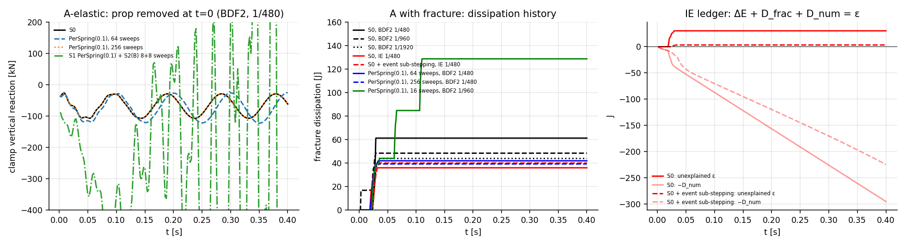

# E7 — Game-scale structures: support loss, lateral push, free fall

**Run:** `cargo run --release --bin e7` (≈10 min) → `results/E7/` (`summary.json`, `series.csv`); stability diagnostic `SB_E7_DIAG=1 cargo run --release --bin e7` → `results/E7/diag.json`; figure `python3 analysis/plot_e7.py`.
**Scenarios** (reference concrete, $b=0.3$ m, gravity):
- **A:** 8 m × 1.2 m beam, cells ≈0.3 m (84 cells, $\ell_e/l_{ch}\in[0.04,1.77]$), clamped left face, propped at the right end; prop removed at $t=0$. Run elastic (A-elastic) and with SB-IL1 fracture.
- **B:** 1 m × 4 m column, clamped base, sudden 60 kN lateral load at the top (static cracking estimate ≈38 kN).
- **C1:** unloaded 3 m × 1 m block in free fall. **C2:** the same block clamped under gravity, then released.

**Solvers per step:** S0 Newton | S0 + event sub-stepping (implicit Euler, halve while $\max\Delta d>0.2$) | S1 with the ALM note's $\rho=m_{\rm eff}/h^2$ ("dyn-ρ") or per-spring $\rho=0.1k$ | S1 + S2(A) (forces reported only) | S1 + S2(B) (8 sweeps, S2 with d'Alembert loads, inject λ, 8 sweeps). History committed at step end. **Baseline integrator BDF2** (E8 decision), $h=1/480$ s unless stated.

## Results

**A-elastic** (isolates solver/coupling error from fracture). History of the clamp reaction over 0.4 s compared with S0:

| solver | relative RMS error of reaction history | peak force / failure force (S0: 1.9) |
|---|---|---|
| S1 dyn-ρ, 16 sweeps | **diverges** (energy ~10²⁴ J) | 10¹¹ |
| S1 per-spring, 16 sweeps | **diverges** (10⁹ J) | 7 700 |
| S1 per-spring, 64 sweeps | 35 % | 2.2 |
| S1 per-spring, 256 sweeps | 0.03 % | 1.9 |
| S1 per-spring + S2(B) 8+8 | 710 % | 17 |

Diagnostic over integrators, elastic A, 0.2 s:

| | 1 | 4 | 16 | 64 | 256 sweeps |
|---|---|---|---|---|---|
| dyn-ρ, IE / BDF2 / Newmark | diverge | diverge | diverge | diverge | stable |
| per-spring, IE | — | diverges | 8.6× failure | 2.8× | 1.8× |
| S3, IE | — | 85× failure, +3·10⁵ J | 62×, +1.8·10⁵ J | 22× | 6× |

**Budgeted local solvers are dynamically unstable, not just inaccurate.** The instability is independent of the integrator. It is strongest for the ALM note's policy $\rho=m_{\rm eff}/h^2$ ($\pi_h\approx200$ here, so $\rho\ll k$: E1's slow dual). Without multipliers (S3) it does not diverge exponentially but creates energy massively. The warm-started multipliers are state that lags the motion, and a lagging restoring force pumps energy into the oscillation.

**A with fracture** (fracture dissipation over 0.4 s; S0 rows give the model's own spread):

| solver | $h$ | $D$ [J] | broken facets | remarks |
|---|---|---|---|---|
| S0 (BDF2) | 1/480 | 61.3 | 8 | branch depends on the initial guess: 38.1 J with the bare inertial predictor (first run) |
| S0 (BDF2) | 1/960 | 48.4 | 7 | |
| S0 (BDF2) | 1/1920 | 44.0 | 6 | converging under $h$-refinement |
| S0 (IE) | 1/480 | 36.0 | 4 | facets break in one step; **ledger ε = +30.3 J** |
| S0 (IE) + event sub-stepping | 1/480 | 40.0 | 7 | +48 % substeps (285/192); **ε = +3.3 J** |
| S0 $d_{\min}$ 0.2 / 0.5 + crack band | 1/480 | 36.0 / 43.8 | 6 / 5 | |
| S1 dyn-ρ, 16 sweeps | 1/480 | 486 | 65 | spurious fracture, energy created (+518 J) |
| S1 per-spring, 16 sweeps | 1/480 | 1 435 | 204 (all) | diverged |
| S1 per-spring, 16 sweeps | 1/960, 1/1920 | 129, 144 | 19, 21 | 3× too much fracture |
| S1 per-spring, 64 / 256 sweeps | 1/480 | 42.0 / 39.3 | 7 / 6 | within S0's spread |
| S1 per-spring + S2(B) 8+8 | 1/480 | 1 435 | 204 | diverged; 66 S2 mechanism refusals |

**B column, lateral push:** S0 63.5 J, 12 broken facets. S1 per-spring at 16 and 64 sweeps and S1+S2(B) all **diverge** (127 facets broken).

**C1 free fall:** S0 max facet force $4\times10^{-10}$ of failure: zero self-weight stress to round-off, as required. S1 is clean *only* with a predictor that includes the external force, $\hat q+(h^2/\alpha)M^{-1}f$. With the bare inertial predictor (first run), colour-sequential S1 strained the falling block by ~$h^2g/\ell\approx$ the failure strain and **broke 7 facets**. S2(B) injected forces up to 19 % of failure into the stress-free block (the $M\,\delta a$ error) before the predictor fix, and $<10^{-11}$ after it.
**C2 release of a pre-loaded block:** S0 shows elastic vibration with no damage. S1 dyn-ρ breaks 11 facets (77 J); S1 per-spring is clean.

## Interpretation

- **Load redistribution after support loss.** S0 redistributes within the integrator's response, a few steps plus a 10 Hz vibration that BDF2 keeps. Under 8–16 sweeps, S1 does not lag gracefully: it diverges or fractures spuriously. "Redistribution timing" is not a meaningful S1 metric at this budget. At 64 sweeps the elastic history is still 35 % off; at 256 sweeps it matches.
- **S2 does not rescue S1.** A static reconstruction $Ku=f-Ma$ needs the S1 acceleration. Under budget that acceleration is wrong, sometimes by orders of magnitude, so (A) reports garbage forces and (B) injects them into the dual and destabilises it. Fracture adds near-mechanisms; 22–185 refusals per run are reported, never regularised. Consistent with the spec's warning that an accurate reconstruction cannot repair incorrect acceleration.
- **S0 itself raises two issues for Phase 1.** (i) Under softening the step problem is non-convex: the initial guess selected a 38 J vs a 61 J branch. Deterministic tie-breaking gives reproducibility, not physics, so branch selection needs a rule (event sub-stepping and $h$-refinement both move results toward ≈40–44 J). (ii) Breaking a facet within one step leaves a signed ledger residual of up to 84 % of $D$: the law's dissipation is not what the step mechanics released. Event sub-stepping cuts it to 8 % at +48 % cost. **The energy ledger works as the detector it was designed to be.**
- Mesh and crack band: $d_{\min}$ 0.2 / 0.3 / 0.5 (+ crack band η = 0.95) gives 36 / 36–61 / 44 J. That is a ±25 % spread at game scale, of the same order as the $h$ and branch spread. Game-scale objectivity is not established by these few runs.
- Validity window: after the root hinge forms the beam rotates ~0.1 rad and the crack opens by decimetres. That is beyond the local-interface regime of the law. Results past the first ~0.05 s are qualitative.
