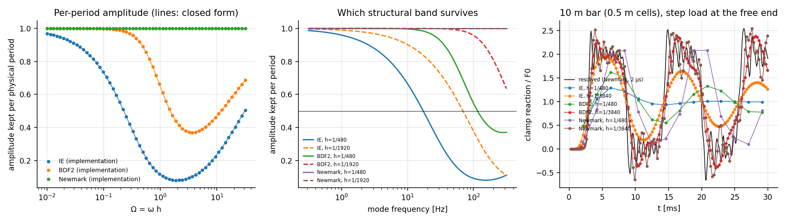

# E8 — Time discretisation

**Run:** `cargo run --release --bin e8` (≈1 s) → `results/E8/`; figure `python3 analysis/plot_e8.py`.
**Integrators:** implicit Euler (IE), BDF2 and Newmark average acceleration, all written as incremental-potential minimisations (docs §4.4) and stepped by S0 Newton.

## 1. Validation of the implementation

The one-step map $G$ (5×5 on $(q,q_{n-1},v,v_{n-1},a)$) was extracted from the actual code by stepping each basis state of a 1-DOF facet oscillator. Its principal eigenvalue was compared with the closed forms over $\Omega=\omega h\in[10^{-2},10^{1.5}]$ (61 points):

| scheme | max rel. deviation of $\lvert z\rvert$, arg $z$ |
|---|---|
| IE, $z=1/(1-i\Omega)$ | $2.7\times10^{-10}$ |
| BDF2, $z=(2+\sqrt{1+2i\Omega})/(3-2i\Omega)$ | $3.7\times10^{-11}$ |
| Newmark, $z=(1+i\Omega/2)/(1-i\Omega/2)$ | $1.5\times10^{-11}$ |

*(A first extraction with unit-agnostic perturbations of an off-origin cell showed 40–200 % "deviations" at small Ω: the round-off of absolute coordinates again (cf. E4). Perturbations are now scaled per state unit and the cell is centred at the origin.)*

## 2. Surviving frequency band

Amplitude kept **per period** of a mode (closed forms, validated above):

| scheme, $h$ | 10 Hz | 50 Hz | 100 Hz | $f$ keeping ≥ 90 % / period | ≥ 50 % / period |
|---|---|---|---|---|---|
| IE 1/240 | 0.45 | 0.09 | — | 1.3 Hz | 8 Hz |
| **IE 1/480** | **0.67** (1.7 % left after 1 s) | 0.18 | — | 2.5 Hz | 17 Hz |
| IE 1/960 | 0.82 | 0.38 | — | 5 Hz | 34 Hz |
| IE 1/1920 | 0.90 | 0.60 | — | 10 Hz | 67 Hz |
| BDF2 1/240 | 0.98 | 0.55 | — | 17 Hz | 56 Hz |
| **BDF2 1/480** | **0.997** (97 % after 1 s) | 0.81 | — | 36 Hz | 112 Hz |
| BDF2 1/960 | 1.000 | 0.96 | — | 72 Hz | 224 Hz |
| Newmark (any) | 1.000 | 1.000 | 1.000 | all | all |

Newmark's only error is period elongation (1/480: 0.1 % at 10 Hz, 3.5 % at 50 Hz, 13 % at 100 Hz). Game-scale structural modes are typically ~10 Hz (e.g. a 6 m concrete cantilever 0.6 m deep: $f_1\approx9.5$ Hz). **At 1/480 s implicit Euler removes a third of such a mode per oscillation and essentially all of it within a second**, which confirms P-E8.

## 3. Bar under a step load (dynamic amplification)

10 m bar of 20 cells (0.5 m), clamped, step force $F_0$ at the free end; $L/c=2.83$ ms, $f_1=88$ Hz. The resolved reference (Newmark, 2 µs) shows arrival at 2.77 ms and a peak clamp reaction of **2.55 F₀**: the lattice's dynamic amplification, above the continuum's 2 because of dispersive ringing at the front.

| $h$ | $c h/\ell$ | IE peak / F₀ | BDF2 | Newmark |
|---|---|---|---|---|
| 1/240 | 29 | 1.13 | 1.31 | 1.85 |
| **1/480** | **15** | **1.29** | 1.63 | 2.09 |
| 1/960 | 7.4 | 1.54 | 2.04 | 2.61 |
| 1/1920 | 3.7 | 1.82 | 2.23 | 2.78 |
| 1/3840 | 1.8 | 1.97 | 2.39 | 2.55 |
| 1/7680 | 0.9 | 2.00 | 2.43 | 2.67 |

- Arrival time is not resolved for $h\gtrsim L/c$. The implicit step makes the response elliptic: the reaction appears within the first step. This is not a wave arrival (context §6.7: "$c\Delta t$ does not bound arrival error").
- **Implicit Euler at game substeps under-predicts the peak force of a sudden load by ≈2×** (1.29 vs 2.55). Support loss and impacts are sudden loads, and fracture is triggered by peaks. A structure that should crack from the dynamic overshoot will not.

## Decision

Decision-map entry "E8 shows unacceptable damping → change integrator before further solver work": **triggered for implicit Euler.** BDF2 fits the same variational solver structure: $\alpha=9/4$ plus one more history vector, L-stable, so post-fracture high-frequency noise still dies out. At 1/960 s it recovers the step-load amplification of 2 and keeps 10 Hz modes at ≥99 % per period. Newmark is the least dissipative but never damps the post-event ringing. E7/E9 use **BDF2 as the baseline** and keep IE as the comparison.

Limits: linear, undamped analysis. Physical damping (concrete ~2–5 %) would itself remove part of the response; the integrator's damping must then be compared with that physical target. Fracture-induced high-frequency content (unresolved spall) is out of scope here (context §6.7).
