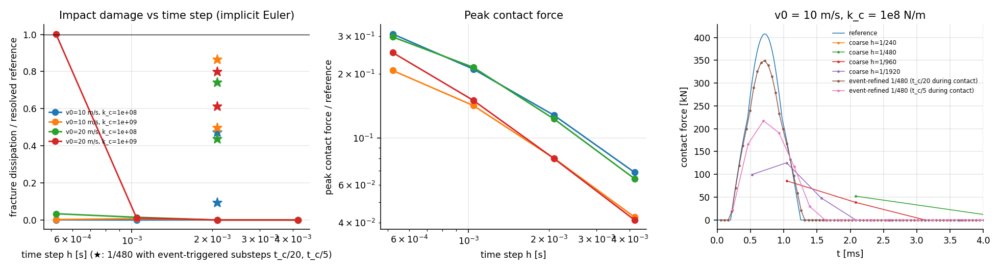

# E9 — Impact

**Run:** `cargo run --release --bin e9` (≈1 min) → `results/E9/`; figure `python3 analysis/plot_e9.py`.
**Setup:** concrete block 1.0 m × 0.5 m × 0.2 m, $d_{\min}=0.05$ m (≈140 cells), clamped base, SB-IL1. Rigid steel disk (R = 5 cm, 12.3 kg) at $v_0\in\{10,20\}$ m/s (KE 0.62 / 2.47 kJ). Contact: unilateral frictionless point facets, rebuilt each (sub)step at the current closest points ("manifold once per step"), stiffness $k_c\in\{10^8,10^9\}$ N/m, i.e. contact duration $t_c=\pi\sqrt{m/k_c}=1.1$ / 0.35 ms. Implicit Euler throughout, to isolate the step-size effect (E8's damping caveat applies). Reference: $h=\min(t_c/100, 5\,\mu s)$.
**Event-triggered refinement:** an outer step whose predicted gap is below $|v|h$ + 5 mm runs in substeps $t_c/20$ or $t_c/5$. Deterministic, triggered by simulation state.

## Results

Fracture dissipation $D$ (J) and broken facets; R = restitution $|v_{\rm end}|/v_0$:

| $v_0$, $k_c$ | reference | 1/240 | 1/480 | 1/960 | 1/1920 | 1/480 + $t_c/20$ | 1/480 + $t_c/5$ |
|---|---|---|---|---|---|---|---|
| 10, 1e8 | **27.6** (30), R 0.93 | 0.0 | 0.0 | 0.0 | 0.01 | 13.0 (13), R 0.74 | 2.5 |
| 10, 1e9 | **126** (142), R 0.54 | 0.0 | 0.0 | 0.9 | 0.3 | 109 (125), R 0.49 | 63 |
| 20, 1e8 | **149** (181), R 0.77 | 0.0 | 0.0 | 2.1 | 5.0 | 110 (137), R 0.59 | 65 |
| 20, 1e9 | **221** (277), R 0.50 | 0.0 | 0.0 | 2.5 | 222 (!) | 177 (224), R 0.45 | 136 |

Peak contact force at coarse steps is 4–30 % of the resolved peak (e.g. 52 kN vs 408 kN at 1/480). Coarse steps return a restitution ≈0: implicit Euler makes the impact perfectly inelastic and dissipates the kinetic energy numerically instead of in fracture.

## Interpretation (decision map: "E9 shows strong h-dependence → impact duration model becomes part of the core model": **triggered**)

- At game substeps (≥ 1 ms) **impacts produce essentially no fracture**: 0–2 % of the resolved dissipation, with an erratic outlier (1/1920 at 20 m/s and $10^9$ matches the reference by coincidence, while 1/960 gives 1 %). The $J/\Delta t$ force interpretation is the cause (context §6.7).
- The damage outcome depends on $k_c$ by up to 4.6× at the same impulse. **Contact compliance (duration, peak force) is a physical parameter of the impact**, not a numerical one. A Hertz-based duration model (Hahn–Wojtan) is the natural candidate. It was **not prototyped here**: there was no time left for it, and it is the next E9 step.
- Event-triggered substeps at $t_c/20$ recover 47–86 % of the resolved dissipation (80–720 substeps per run instead of 6). The remainder comes from the coarse steps right after contact, where the block's dynamic response (wave transit 0.14 ms, $c\,h/\ell$ = 150) is again elliptic. Refining only the contact is not enough; the structure's response must be refined for a few transit times as well.
- Determinism note: the refinement trigger is a function of simulation state only (predicted gap), as context §2.2 requires of physical LOD.
