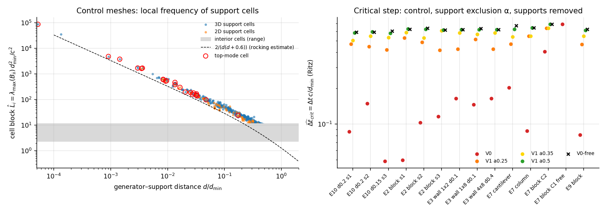
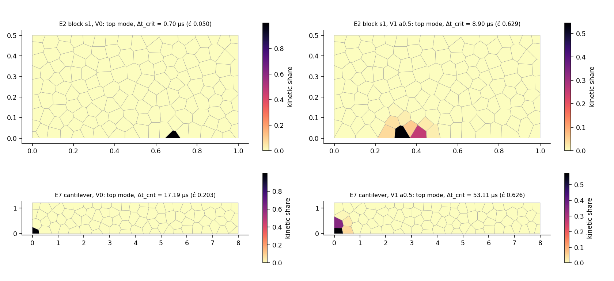
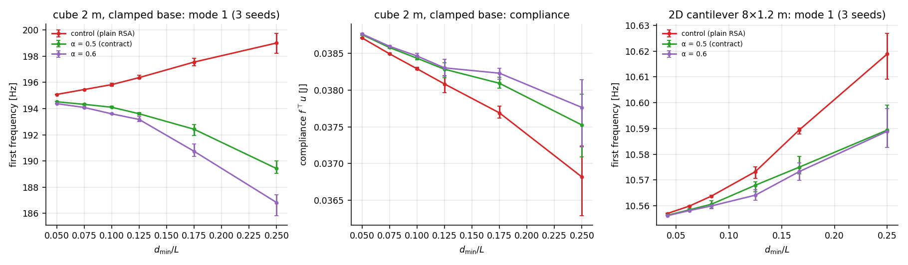
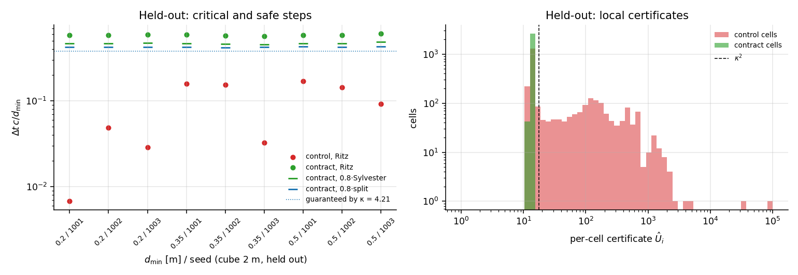
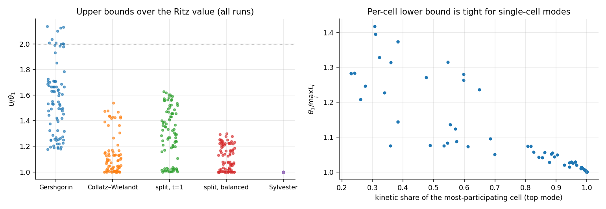

# Phase 0b / 1 — Geometry contract and spectrum (CPU f64)

*Assignment: `shatterbird-phase0b.md` §4. §1–§3 (theory, method, pre-registration) were written **before** any variant was compared and are unchanged. §4–§6 hold the results; post-hoc work and corrected judgements are marked **[rev]** or "post-hoc".*

## 1. Theory

### 1.1 The discrete problem

At rest, the linearised RBSN is a sum of rank-one spring components:
$$K=\sum_c k_c\,j_cj_c^\top,\qquad M=\operatorname{blockdiag}(m_iI,\;J_i).$$
- 2D: two points per facet, normal and tangential components, $k_n^p=EA_p/\ell_e$, $k_t^p=\gamma k_n^p$; $J_i$ is the polar inertia.
- 3D (E10 model): per facet, three translational components at the facet centroid and three rotational ones (bending about the principal in-plane axes, torsion); $J_i$ is the full inertia tensor about the centroid.

Supports are springs to a fixed body: their DOFs are not unknowns, nothing else is fixed, and free zero modes are kept.

The undamped linear central-difference/Verlet step is stable iff $\Delta t\le2/\omega_{\max}$, with $\omega^2_{\max}=\lambda_{\max}$ of $K\phi=\lambda M\phi$. The symmetric form is
$$B=M^{-1/2}KM^{-1/2}=\sum_c k_c\,v_cv_c^\top,\qquad v_c=M^{-1/2}j_c .$$
$M^{-1/2}$ is per cell: $m_i^{-1/2}$ on translations and $J_i^{-1/2}$ (from the 3×3 eigendecomposition) on rotations. All spectral quantities are reported dimensionless: $\hat\lambda=\lambda\,d_{\min}^2/c^2$ and $\widehat{\Delta t}=\Delta t\,c/d_{\min}$, with $c=\sqrt{E/\rho}=3536$ m/s and $d_{\min}$ the RSA seeding distance. $\hat\lambda$ depends on geometry only, not on $E$ or $\rho$.

### 1.2 Bounds (what can be certified)

**Lower bounds on $\lambda_{\max}$ (upper bounds on $\Delta t_{\rm crit}$):**
- every Rayleigh quotient, hence every Ritz value;
- every principal submatrix, in particular the per-cell block $B_{ii}$: $L_i=\lambda_{\max}(B_{ii})$. The "physical diagonal block" numbers in the assignment (4.87 / 8.43 / 2.06 µs for E10) are of this kind.

**Upper bounds** (each valid in exact arithmetic):
1. *Gershgorin* on $B$: $\max_i\sum_j|B_{ij}|$.
2. *Collatz–Wielandt* on $|B|$: $\lambda_{\max}(B)\le\rho(|B|)\le\max_i(|B|x)_i/x_i$ for any $x>0$. A few power steps on $|B|$ from $x=\mathbf 1$ tighten Gershgorin.
3. *Cell splitting (local certificate).* A component touches at most two cells: $v_c=v_{c,a}+v_{c,b}$. For any $t_c>0$,
   $$(v_c\!\cdot\!x)^2\le(1+t_c)(v_{c,a}\!\cdot\!x_a)^2+(1+t_c^{-1})(v_{c,b}\!\cdot\!x_b)^2 ,$$
   so $x^\top Bx\le\sum_i x_i^\top G_ix_i$ with $G_i=\sum_{c\ni i}k_cw_{c,i}v_{c,i}v_{c,i}^\top$, where $w_{c,a}=1+t_c$, $w_{c,b}=1+t_c^{-1}$, and $w=1$ for support components. Hence
   $$\lambda_{\max}(B)\le U_{\rm split}=\max_i U_i,\qquad U_i=\lambda_{\max}(G_i).$$
   With $t_c=1$ this reads $G_i\preceq2B_{ii}$, so
   $$\max_iL_i\;\le\;\lambda_{\max}(B)\;\le\;2\max_iL_i .$$
   **The critical step is bracketed within a factor $\sqrt2$ by quantities local to single cells.** That is the basis for a per-cell, O(valence), deterministic asset check. The weights $t_c$ are free, so they are balanced iteratively ($t_c\leftarrow t_c\sqrt{U_b/U_a}$), and the minimum over iterates is reported.
4. *Sylvester inertia certificate.* $\lambda_{\max}<\sigma$ iff $\sigma M-K\succ0$, which a sparse Cholesky decides. Bisection between the Ritz value and $U_{\rm split}$ gives a certified bound essentially at $\lambda_{\max}$, and it rules out a missed higher mode. In f64 the factorisation is backward stable to roughly $n_{\rm col}\varepsilon$ relative. A declared relative margin of $10^{-9}$ is added. This is an offline (asset-pipeline) certificate; it proves nothing about a future fixed-point implementation.

Reported per case:
- $\widehat{\Delta t}_{\rm crit}=2/\sqrt{\theta_1}$ (Ritz estimate, not a certificate);
- $\Delta t_{\rm safe}=0.8\cdot2/\sqrt U$, for both $U_{\rm split}$ (local) and $U_{\rm Syl}$ (global);
- $N_{\rm safe}=\lceil1/(60\Delta t_{\rm safe})\rceil$;
- the gaps $U/\theta_1$.

### 1.3 Expected cause: generators close to a rigid support

Phase 0 sets $\ell_e=d$ (generator to support plane) for support facets; uniformity requires this. RSA constrains generator–generator distances but **not** generator–support distances, and $d$ is uniform on $[0,\sim d_{\min}]$ in the support layer.

Consider a support cell with base (support-facet) area $A_s$, height $H\approx d+\ell/2$ and volume $\approx A_sH$:
- Translation normal to the support: $\omega^2\approx k/m=c^2/(dH)$.
- Rocking (support facet offset by $\approx H/2$ from the centroid, tangential spring $EA_s/d$): $\omega^2\approx2c^2/(dH)$.

For the interior, a cubic lattice of spacing $\ell$ (γ=1) has $\omega^2_{\max}\approx12c^2/\ell^2$ (checkerboard translation; checkerboard rotation 8, uniform rotation 12).

The support cell becomes the extreme mode when $2/(dH)>12/\ell^2$, i.e. $d\lesssim0.3\ell$, and $\Delta t_{\rm crit}\propto\sqrt d$ as $d\to0$. Mass and inertia, by contrast, are bounded below: every RSA Voronoi cell contains the ball (half-ball at a face, octant at a corner) of radius $d_{\min}/2$ around its generator, and its inertia about the centroid is at least that ball's. Cell–cell $\ell_e\ge d_{\min}$, and facet areas are bounded in a saturated RSA. So without supports or contacts, $\hat\lambda_{\max}$ is bounded by a geometry-independent constant; only $d\to0$ (and contact stiffness) is unbounded.

The mirror-consistent rule $d\ge d_{\min}/2$ (the generator's mirror image across the support respects the RSA spacing) gives $d\gtrsim0.4\ell$. That is just on the safe side of the estimate above.

### 1.4 What a geometry fix may and may not change

- Moving or removing generators keeps a Voronoi tessellation. Facet normals stay $\parallel g_b-g_a$, $\ell_e=|g_b-g_a|$, and support $\ell_e=d$. Uniform strain therefore remains an exact solution: the E4 property carries over, and in 3D the clamped uniaxial test (γ=1, ν=0, free lateral faces) has the exact solution $u_i=\varepsilon\,g_{i,z}e_z$, $\omega_i=0$.
- Merging cells does not keep this. A merged body has one rigid motion but several generator-defined facets, so the patch test fails, and it would be a new discretisation.
- Support layer: compliance and low frequencies change only through discretisation error near the support. Material, loads, specimen and boundary conditions stay fixed.

## 2. Method

**Lanczos.**
- Symmetric Lanczos on $B$ with full re-orthogonalisation (classical Gram–Schmidt, applied twice).
- Matrix-vector products are counted.
- Two reproducible start vectors: uniform in $[-1,1]$ from `Rng` seeds 11 and 12.
- Stop when the top $p=10$ Ritz pairs have estimated residual $\beta_k|s_{k,i}|\le10^{-10}\theta_1$ (or 600 steps); the residuals are then recomputed explicitly.
- **Normalised residual:** $\eta_i=\|By_i-\theta_iy_i\|_2/(\theta_i\|y_i\|_2)$, equivalently $\|K\phi-\theta M\phi\|_{M^{-1}}/(\theta\|\phi\|_M)$.
- Reference: dense symmetric diagonalisation of $B$ (faer) for $n\le3000$.
- Near-degenerate top values (relative gap $<10^{-3}$) are analysed as a subspace (summed localisation).

**Low frequencies.** Shift-invert Lanczos on $B^{-1}=M^{1/2}K^{-1}M^{1/2}$, using the sparse Cholesky of $K$ (clamped cases only), with the same residual definition.

**Localisation of the top modes** ($y$ normalised in $B$-space):
- Kinetic share per cell is $\|y_i\|^2$, split into translation and rotation.
- Elastic share per component is $k_c(v_c\cdot y)^2/\theta$; it sums to 1 and is grouped per facet and per class (cell–cell, support, contact).
- Also reported: shares of the top 1/5/10 cells and the participation number $1/\sum_i\|y_i\|^4$.

**Per-cell features:**
- generator–support distance $d/d_{\min}$;
- $V/d_{\min}^3$, mass, and minimum principal inertia $/(m d_{\min}^2)$;
- elongation $\sqrt{c_{\max}/c_{\min}}$ of the second-moment tensor;
- nearest generator distance $/d_{\min}$;
- maximum facet area $/d_{\min}^{2}$ (2D: length), maximum arm $/d_{\min}$, valence;
- support/contact stiffness share;
- $\hat L_i$, $\hat U_i$.

## 3. Pre-registration (fixed before any variant was compared)

**Development cases (original seeds, original construction):**
- **3D:** E10 box 1 m, clamped bottom face, RSA max_fail 5000: $d_{\min}$ 0.2 seeds 1 and 2; $d_{\min}$ 0.15 seed 3.
- **2D:**
  - E2: 1 × 0.5 m, $d_{\min}$ 0.05, seeds 1–3, clamped base.
  - E3: wall 1 × 2 m, $d_{\min}$ 0.1; wall 1 × 8 m, $d_{\min}$ 0.1; wall 4 × 8 m, $d_{\min}$ 0.4; seed 1, clamped base.
  - E7: cantilever 8 × 1.2 m, $d_{\min}$ 0.3, seed 7 (clamped left edge plus prop on bottom $x\in[7.4,8]$); column 1 × 4 m, $d_{\min}$ 0.25, seed 3; block 3 × 1 m, $d_{\min}$ 0.3, seed 5 (clamped left edge, C2, and free, C1).
  - E9: 1 × 0.5 m, $d_{\min}$ 0.05, seed 9, clamped base. Separately with the projectile (12.3 kg, θ fixed) and contact springs $k_c\in\{10^8,10^9\}$ N/m to the cells under the impact point, at first touch.
- Laws: elastic stiffness at rest. Unilateral and contact laws are taken at their compression stiffness.

**Variants:**
- **V0** — control.
- **V0-free** — diagnostic only, not a fix: supports removed.
- **V1(α)** — support exclusion by *repair*. Generators with distance $<\alpha d_{\min}$ to a supported boundary are removed; RSA then continues from the same RNG state, with every trial also obeying the exclusion, until max_fail. $\alpha\in\{0.25,0.35,0.5\}$; **primary α = 0.5** (mirror-consistent). The exclusion zone of a partial support (E7 prop) is the supported segment extended by $d_{\min}$.
- **V2** (consistent boundary layer), **V3** (minimum volume / inertia / elongation), **V4** (merging): run only if the localisation after V1 shows outliers of that kind. Otherwise they are reported as not needed.
- **Inertia-scaling diagnostic:** only if the top modes remain local *and* rotation-dominated after geometry control. Uniform rotational-inertia factors 2 and 4. Reported separately and never called a fix.

**Decision rule for α.**
- The final α is the smallest of the three for which, in every development case, the top mode is no longer a support-cell outlier: the largest $L_i$ over support cells is ≤ 1.1 × the largest over the other cells, and $\theta_1$ lies within 10 % of V0-free.
- If several α qualify with equal results, take 0.5 for its construction argument.

**Contract constant.**
- $\kappa=\max_i\sqrt{\hat U_i}$ over all cells of the 3D development cases under the final variant, rounded up by 10 %. It is fixed before the held-out run.
- An asset passes if all cells satisfy $\hat U_i\le\kappa^2$; then $\Delta t_{\rm safe}\ge0.8\cdot2/\kappa\cdot d_{\min}/c$ holds without any global computation.

**Held-out cases** (not looked at before the contract is fixed):
- 3D cube 2 × 2 × 2 m, clamped bottom face;
- $d_{\min}\in\{0.2,0.35,0.5\}$ m (the nominal game sizes are the seeding distance; realised cell sizes are reported);
- seeds **1001, 1002, 1003**;
- control = plain RSA; variant = constrained RSA from scratch, with the exclusion applied at every trial.

**Acceptance and tolerances:**
- **Spectral:** $\eta\le10^{-8}$ for the reported top pairs; $\lambda_{\max}$ equal to the dense value within $10^{-6}$ relative ($n\le3000$); both start vectors agree within $10^{-8}$.
- **Mechanics:**
  - $\sum V_i=V_\Omega$ within $10^{-10}$ relative; all $m_i$ and principal $J_i$ positive; total first and second moments within $10^{-10}$ relative of the exact box values; facet areas equal from both sides within $10^{-9}$.
  - Clamped uniaxial patch test: maximum displacement and facet-traction error $\le10^{-9}$ relative.
  - Compliance (mean top displacement and base moment under the E10 load) and the lowest 6 frequencies within **3 %** of the control on the same seed (repair variants). For held-out sets, the variant mean must lie within the control's seed spread.
- Material, loads, specimen and boundary conditions are never changed together with geometry.

**Predictions:**
- **P1.** In every supported control case the top mode is localised (≥ 80 % kinetic share in ≤ 2 cells) on a support cell with small $d$, and ≥ 50 % of its elastic energy is in support facets.
- **P2.** Control $\Delta t_{\rm crit}$ follows $\sqrt{d_{\rm sup,min}}$. V0-free gives $\widehat{\Delta t}_{\rm crit}\approx0.4$–0.6 (3D) and 0.5–0.8 (2D).
- **P3.** α = 0.5 removes the support outlier and brings $\widehat{\Delta t}_{\rm crit}$ to the V0-free level within 10 %. The top modes stay localised on interior cells, which is normal for disordered lattices and not a defect by itself.
- **P4.** $U_{\rm split}/\theta_1\in[1.2,2]$; Gershgorin is looser. The per-cell lower bound reproduces 4.87 / 8.43 / 2.06 µs.
- **P5.** Mechanics: the patch test is exact; compliance and low frequencies change by ≤ 3 %.
- **P6.** E9 contact at $k_c\le10^9$ N/m does not set the top frequency: $\omega_c\approx\sqrt{k_c(1/m_p+1/m_{\rm cell})}\approx2.4\cdot10^4$ rad/s, against a network value of about $2\cdot10^5$. It would at $k_c\gtrsim10^{11}$ N/m.

## 4. Results

**Run:** `cargo run --release --bin geo_spectrum` (≈3 min; the pre-registered part takes 32 s, the post-hoc refinement the rest) → `results/phase0b/geometry-spectrum/`:
- `summary.json`: per-run spectra, bounds, localisation, mechanics, sizes, decisions;
- `cases.csv`, `cells.csv` (per-cell features, $\hat L_i$, $\hat U_i$, top-mode shares), `modes.csv` (both start vectors, dense values), `polys2d.csv`, `posthoc_refinement.csv`.

Figures: `python3 analysis/plot_geo_spectrum.py`. Source hash and law version are in `summary.json/meta`.

### 4.1 Spectral verification (§4.5 gate)

| check | target | result (98 pre-registered runs) |
|---|---|---|
| normalised residual η of the 10 top pairs, both start vectors | ≤ 1e-8 | max **7.1e-10** |
| θ₁ from start vectors 11 vs 12 | ≤ 1e-8 | max 2.9e-15 |
| θ₁ vs dense diagonalisation (92 runs with n ≤ 3000) | ≤ 1e-6 | max **7.5e-14** |
| Sylvester: is σM − K PD at σ = θ₁(1+1e-6)? | — | **98/98 at the first factorisation**: no missed higher mode; λ_max ∈ [θ₁, θ₁(1+1.001e-6)] |
| zero modes with supports removed (dense) | 6 (3D), 3 (2D) | 6 / 3 in every case; rigid rotations are null vectors of K to 6e-19 |
| Lanczos cost | — | 25–245 matvecs for 10 pairs to $10^{-10}\theta_1$ (the step cap is 800 in the code, not the 600 of §2; it was never reached) |

**Implementation finding.** faer 0.24's dense symmetric eigensolver (`self_adjoint_eigen`), applied to the Lanczos tridiagonal, returned eigenvectors with residuals up to 4e-6 and eigenvalues off by ~3e-11. The Lanczos basis itself was clean: orthogonality 3e-16, three-term relation 3e-15. The tridiagonal is now solved by implicit QL (`tridiag_eig`) and the small blocks by Jacobi; after that, Ritz residuals are 1e-15–1e-12. None of the conclusions rests on faer's eigensolver: the certified brackets come from Cholesky.

### 4.2 What creates the extreme frequencies

Control meshes (original seeds and construction, physical masses):

| case | cells | min $d/d_{\min}$ | $\hat\theta_1$ | $\Delta t_{\rm crit}$ [µs] | $\widehat{\Delta t}$ | top-cell kinetic share | support elastic share | rotation share | $\widehat{\Delta t}$, supports removed |
|---|---|---|---|---|---|---|---|---|---|
| E10 d0.2 s1 | 109 | 0.0096 | 540 | **4.87** | 0.086 | 1.00 | 0.99 | 0.69 | 0.595 |
| E10 d0.2 s2 | 112 | 0.0285 | 180 | **8.43** | 0.149 | 1.00 | 0.98 | 0.67 | 0.594 |
| E10 d0.15 s3 | 246 | 0.0036 | 1692 | **2.06** | 0.049 | 1.00 | 1.00 | 0.70 | 0.606 |
| E2 block s1 | 145 | 0.0035 | 1629 | 0.70 | 0.050 | 1.00 | 1.00 | 0.77 | 0.625 |
| E2 block s2 | 145 | 0.0135 | 380 | 1.45 | 0.103 | 1.00 | 0.99 | 0.68 | 0.639 |
| E2 block s3 | 146 | 0.0165 | 298 | 1.64 | 0.116 | 1.00 | 0.98 | 0.71 | 0.620 |
| E3 wall 1×2, $d_{\min}$ 0.1 | 149 | 0.0318 | 149 | 4.64 | 0.164 | 1.00 | 0.97 | 0.73 | 0.625 |
| E3 wall 1×8, $d_{\min}$ 0.1 | 571 | 0.0252 | 187 | 4.13 | 0.146 | 1.00 | 0.98 | 0.74 | 0.634 |
| E3 wall 4×8, $d_{\min}$ 0.4 | 149 | 0.0318 | 149 | 18.56 | 0.164 | 1.00 | 0.97 | 0.73 | 0.625 |
| E7 cantilever | 84 | 0.0473 | 97 | 17.19 | 0.203 | 1.00 | 0.97 | 0.72 | 0.670 |
| E7 column | 52 | 0.0092 | 523 | 6.18 | 0.087 | 1.00 | 0.99 | 0.70 | 0.645 |
| E7 block C2 | 27 | 0.1722 | 24 | 34.62 | 0.408 | 1.00 | 0.89 | 0.75 | 0.689 |
| E9 block | 148 | 0.0083 | 607 | 1.15 | 0.081 | 1.00 | 0.99 | 0.77 | 0.629 |
| held-out cube, 9 meshes | 59–760 | 5e-5 – 0.033 | 138 – 87 190 | **0.38** – 24.1 | 0.007–0.17 | 1.00 | 0.96–1.00 | 0.66–0.73 | — |

**Cause.** In all 22 supported control meshes (2D and 3D, all scenes, all seeds) the top mode is a **single-cell mode**: kinetic share 1.00 on the support cell with the smallest generator–support distance $d$, with 89–100 % of its elastic energy in that cell's support facets. It is a coupled rocking + translation mode (rotation share 0.66–0.77).
- Among support cells, $\hat L_i$ and $d$ have Spearman rank correlation −0.98 (3D) / −0.99 (2D).
- The rocking estimate $2/(d(d+0.6))$ is a lower envelope within a factor ≈2. As $d\to0$, $\Delta t_{\rm crit}\propto\sqrt d$.
- **The assignment's 4.87 / 8.43 / 2.06 µs are reproduced exactly.** For a single-cell mode the per-cell block bound is tight ($\theta_1/\max L_i=1.000$).

The cause reproduces on the held-out seeds. Plain RSA places $d$ roughly uniformly in the support layer, so the minimum over ~10–90 support cells is an extreme value. The worst held-out mesh had $d=5\cdot10^{-5}d_{\min}$, i.e. $\Delta t_{\rm crit}=0.38$ µs, or 54 000 steps per 60 Hz frame.

**Not causes.**
- With supports removed, $\hat\theta_1=8.4$–11.3 and $\widehat{\Delta t}=0.59$–0.69 in every case.
- Inside a mesh, the local frequency rises for small cells with close neighbours (Spearman with $V$: −0.38 in 3D, −0.62 in 2D; with nearest generator distance: −0.44 / −0.59). Elongation has no correlation (0.07 / −0.07).
- That tail is short and bounded: $\max\hat L_i/p_{99}=1.05$ (3D) and 1.07 (2D). RSA already bounds volume and inertia from below (§1.3).
- So there is no geometric outlier besides supports, and variants **V3 (volume / inertia / elongation limits) and V4 (merging) were not needed**.

Scale invariance holds: the 4×8 m wall at 0.4 is the 1×2 m wall at 0.1 scaled ×4, and it gives identical $\hat\lambda$ to all printed digits, with $\Delta t$ ×4.

### 4.3 Support exclusion: the α series

$\widehat{\Delta t}_{\rm crit}$ (Ritz) on the original seeds, repaired:

| case | V0 | α 0.25 | α 0.35 | α 0.5 | supports removed | α 0.5: $\theta_1/\theta_{\rm free}$ | α 0.5: support/interior block ratio | α 0.5: support elastic share | α 0.5: gain over V0 |
|---|---|---|---|---|---|---|---|---|---|
| E10 d0.2 s1 | 0.086 | 0.470 | 0.504 | 0.585 | 0.595 | 1.031 | 1.22 | 0.40 | 6.8× |
| E10 d0.2 s2 | 0.149 | 0.450 | 0.551 | 0.598 | 0.594 | 0.988 | 1.17 | 0.00 | 4.0× |
| E10 d0.15 s3 | 0.049 | 0.421 | 0.532 | 0.580 | 0.606 | 1.091 | 1.25 | 0.45 | 11.9× |
| E2 block s1 | 0.050 | 0.530 | 0.588 | 0.629 | 0.625 | 0.987 | 1.33 | 0.45 | 12.7× |
| E2 block s2 | 0.103 | 0.488 | 0.532 | 0.629 | 0.639 | 1.035 | 1.31 | 0.53 | 6.1× |
| E2 block s3 | 0.116 | 0.418 | 0.611 | 0.616 | 0.620 | 1.013 | 1.37 | 0.49 | 5.3× |
| E3 wall 1×2 | 0.164 | 0.427 | 0.583 | 0.625 | 0.625 | 1.000 | 1.20 | 0.00 | 3.8× |
| E3 wall 1×8 | 0.146 | 0.516 | 0.570 | 0.625 | 0.634 | 1.029 | 1.13 | 0.00 | 4.3× |
| E7 cantilever | 0.203 | 0.470 | 0.540 | 0.626 | 0.670 | **1.146** | 1.27 | 0.42 | 3.1× |
| E7 column | 0.087 | 0.547 | 0.547 | 0.645 | 0.645 | 1.000 | 0.67 | 0.00 | 7.4× |
| E7 block C2 | 0.408 | 0.638 | 0.638 | 0.689 | 0.689 | 1.000 | 0.97 | 0.00 | 1.7× |
| E9 block | 0.081 | 0.467 | 0.550 | 0.614 | 0.629 | 1.048 | 1.36 | 0.48 | 7.6× |

- At α = 0.25 the support cell is still the top mode (kinetic share 0.93–0.99). At 0.35 it still carries 44–73 % of the top mode's elastic energy.
- α = 0.5 brings $\Delta t$ to within 7 % of the support-free value in all 13 cases, and λ to within 10 % in 12 of them. The exception is the E7 cantilever: 14.6 % in λ (6.6 % in $\Delta t$), at the corner of the clamped edge (figure below).
- **The pre-registered α rule was met by no α.** Its first criterion (largest $L_i$ over support cells ≤ 1.1 × the largest over the others) failed everywhere with ratios 1.13–1.37. As declared, the fallback **α = 0.5** was used.
- **[rev, post-run]** The criterion was mis-specified. A support cell's block is "complete" (its partner is fixed), so its $L_i$ is close to the mode it carries: $\theta/L_i\approx1.0$–1.05. Interior top modes spread over several cells (participation 1.2–9), so their $L_i$ underestimate them by $\theta/L\approx1.2$–1.4 (bounds figure in §4.5, right panel). Comparing block maxima across the two populations is biased against support cells by about that factor. The global quantity, $\theta_1/\theta_{\rm free}$, is the meaningful one.
- What remains true: at α = 0.5 the support layer is still *co-hottest* in 7 of 13 cases (support elastic share 0.40–0.53 of the top mode). It is no longer singular.
- **Post-hoc α = 0.6 / 0.75** (`summary.json/posthoc.larger_alpha`):
  - The support excess disappears (block ratios 0.62–1.14), and the rule passes in 11 / 12 of 13 cases. The cantilever stays at 1.12 because its top mode sits at the clamped corner.
  - $\Delta t$ changes by −1 … +4 % relative to α = 0.5.
  - The same-seed shift of the low frequencies grows: E10 first bending −2.6…−3.9 % (α 0.6) and −2.9…−5.5 % (α 0.75) against the control, versus −1.7…−3.8 % at 0.5.
  - In the refinement below, α = 0.6 is further than 0.5 from the converged 3D first frequency at every resolution, and marginally closer in 3D compliance and in 2D.
  - **α = 0.5 stays the validated contract.** α = 0.6 is a candidate for the next iteration: it removes the support co-hotness at about equal accuracy.

### 4.4 Mechanics after the geometry change (§4.4)

**Exact checks — all passed, on every variant:**

| check | tolerance | worst |
|---|---|---|
| Volume coverage (3D) / area coverage (2D) | 1e-10 | 1.4e-15 / 6.7e-16 |
| Mass | 1e-10 | 1.3e-15 |
| First moment | 1e-10 | 1.8e-17 |
| Second moment about the box centre | 1e-10 | 1.3e-15 |
| Facet areas from both sides (3D) / lengths (2D) | 1e-9 | 2.9e-11 / 3.7e-15 (no unmatched facets) |
| Masses and principal inertias | > 0 | the minimum cell mass *rises* (e.g. 4.0 → 6.1 kg in E10 s1) |
| Clamped uniaxial patch test, displacement | 1e-9 | 2.1e-12 |
| Clamped uniaxial patch test, spring force | 1e-9 | 3.6e-13 |

The patch test was run in 3D and in the 2D base-supported cases. The E4 property carries over because the variant is still a Voronoi tessellation with support $\ell_e=d$ (§1.4).

**Compliance and low frequencies — the pre-registered tolerance failed:**
- *Same-seed comparison, α = 0.5 vs control.*
  - Resolved 2D cases (E2, E3, E9): ≤ 0.8 % in the six lowest frequencies and ≤ 0.25 % in compliance.
  - Coarse cases: E10 $d_{\min}$ 0.2 up to **3.8 %** (first bending pair, s2); E7 cantilever **4.3 %** (mode 3, about 4 cells across the depth); column 2.3 %; C2 2.0 %.
  - So 2 of 13 comparisons exceed the 3 % tolerance.
- *Held-out cube (3 seeds per size).* The contract shifts the first bending frequency by −1.0 / −2.4 / −5.1 % and compliance by +0.3 / +1.0 / +2.1 % at $d_{\min}$ 0.2 / 0.35 / 0.5. The variant mean lies **outside** the control's seed range at every size, so the pre-registered criterion fails.

**[rev, post-hoc] Which one is right?** The pre-registered comparator (the control) is itself a discretisation. A refinement series was run with seeds 2001–2003, not used anywhere else:
- 2 m cube: $d_{\min}$ 0.5 → 0.1, i.e. 63 → 5 300 cells;
- 2D clamped cantilever 8 × 1.2 m: $d_{\min}$ 0.3 → 0.05.

Findings:
- **Both constructions converge to the same limit** (figure below).
- *3D first frequency.* The control is monotonically decreasing and α = 0.5 monotonically increasing. The limit is bracketed: at $d_{\min}/L=0.05$ the two differ by 0.29 % (195.08 / 194.52 Hz). The control errs high and the contract low, with errors of comparable size. A common-limit fit (194.6 Hz; a guide only) gives +0.6 / +1.5 / +2.3 % (control) and −0.3 / −1.1 / −2.7 % (contract) at the game sizes.
- *3D compliance and both 2D quantities.* Both constructions approach the limit from the same side, monotonically, and **the contract is closer at every resolution**. Example: 2D first frequency at $d_{\min}/L=0.25$ is +0.63 % (control) vs +0.35 % (contract) from the fitted limit.
- The errors decay roughly as $(d_{\min}/L)^{1.2\text{–}2.5}$ (fitted exponents): this is a boundary-layer discretisation effect. Near-zero-$d$ cells in plain RSA are effectively rigid inclusions at the clamp (stiff bias). The exclusion layer removes them (slight soft bias in frequency).
- **Conclusion: the contract does not make the elastic mechanics less accurate. It changes the sign of the boundary-layer error in one quantity and reduces it in the others.**

**Partial supports caveat.** In the E7 cantilever the prop covers $x\in[7.4,8]$, about two cells at $d_{\min}$ 0.3. Facets attach by their midpoint, so any change of the tessellation there changes the supported area. At α = 0.6 the cantilever's compliance moved by −13 %. Partial supports at coarse resolution are tessellation-sensitive in any construction, and the support region needs its own geometric rule (aligned facet ends) before such scenes are compared quantitatively.

### 4.5 Contract, steps on physical masses, held-out validation

**Contract** (fixed before the held-out run): $\kappa=4.21$, from the largest development $\sqrt{\hat U_i}=3.82$ plus 10 %. **Asset rejection rules** — an asset is rejected, naming the rule and the cells, if:
1. any generator pair is closer than $d_{\min}$;
2. any generator lies closer than $0.5\,d_{\min}$ to a support plane (for a partial support, within the supported segment extended by $d_{\min}$);
3. the tessellation is not consistent: facet areas from the two sides differ by more than 1e-9 relative, $\sum V_i\ne V_\Omega$ (1e-10), or some mass or principal inertia is ≤ 0;
4. some cell has $\hat U_i>\kappa^2=17.72$. $U_i$ is the balanced splitting certificate: 15 multiplicative sweeps from $t_c=1$, deterministic, O(N). The certificate is $\max_iU_i$; per-cell values locate the offender.

There is no stiffness or mass modification anywhere; a failing asset is regenerated with constrained RSA. A passing asset is **guaranteed** $\Delta t_{\rm safe}\ge0.8\cdot2/\kappa\cdot d_{\min}/c=0.380\,d_{\min}/c$ for the undamped linear problem, with no global computation.

A strictly 1-ring certificate ($t_c=1$) would need $\kappa_1\approx4.4$: its development maximum is 17.8 and held-out values reach 18.6.

**Held-out** (cube 2 × 2 × 2 m, clamped base, seeds 1001–1003; contract construction = constrained RSA from scratch):

| $d_{\min}$ (nominal game size) | cells | realised size $\bar V^{1/3}$ [m] | $\Delta t_{\rm crit}$ Ritz [µs] | $\Delta t_{\rm safe}$, 0.8·Sylvester [µs] | $\Delta t_{\rm safe}$, 0.8·split [µs] | $\Delta t_{\rm safe}$ by κ alone [µs] | steps / 60 Hz frame: Ritz, Sylvester, split, κ | $\max\hat U_i$ (≤ 17.72) | control $\Delta t_{\rm crit}$ [µs] |
|---|---|---|---|---|---|---|---|---|---|
| 0.2 | 687–704 | 0.225–0.227 | 33.1–33.3 | 26.5–26.7 | 23.9–24.0 | 21.5 | 500–504, 625–630, 694–698, 776 | 14.18–14.33 | 0.38 / 2.74 / 1.63 |
| 0.35 | 141–147 | 0.379–0.384 | 56.6–58.3 | 45.3–46.6 | 41.6–42.2 | 37.6 | 286–295, 358–368, 396–401, 443 | 14.09–14.52 | 15.6 / 15.3 / 3.2 |
| 0.5 | 54–58 | 0.517–0.529 | 82.2–86.6 | 65.7–69.3 | 60.1–61.2 | 53.7 | 193–203, 241–254, 273–278, 311 | 13.65–14.19 | 24.1 / 20.3 / 13.1 |

- **The contract holds on all 9 held-out meshes:** no cell exceeds $\kappa^2$, with ≥ 18 % margin.
- Every control mesh fails rules 2 and 4. 60–79 % of plain-RSA support cells lie closer than $0.5d_{\min}$ (3D; 2D: 33–81 % of support facets), and control certificates reach 138–87 190.
- **Realised sizes.**
  - $\bar V^{1/3}/d_{\min}$ = 1.13 / 1.09 / 1.05: smaller at coarse sizes, because a larger share of cells is clipped by the boundary.
  - Equivalent-sphere diameter median: 1.42 / 1.37 / 1.29 $d_{\min}$.
  - The nominal size is the seeding distance, not the cell size.
- **The step is scale-free:** $\widehat{\Delta t}_{\rm crit}=0.57$–0.61 in 3D and 0.61–0.69 in 2D under the contract. It is about $1.7\times$ shorter than the naive $\ell/c$ of the Phase 0 summary.
  - Example at "0.5 m cells": ~200 steps per frame at the stability limit and **241–278 with the 0.8 margin**, not ~130.
  - Gap between the bounds: certified Sylvester / Ritz = $1+10^{-6}$; split / Ritz = 1.00–1.30 (Gershgorin 1.18–2.14).

### 4.6 What remains fast after the contract

- **Rotational "optical" modes of single cells.** With supports removed or excluded, the top modes are rotation-dominated: rotation share 0.76–0.95, participation 1.2–9 cells, top cell 0.23–0.89 of the kinetic energy. They are intrinsic to rigid-cell RBSN with micro-rotations. Their cells are small with few neighbours (median $V$ 0.6 vs 1.2 $d_{\min}^3$, valence 8 vs 11 in 3D).
- **Diagnostic only — rotational inertia scaled uniformly** (the condition "local and rotation-dominated" was met in all three E10 cases):

  | $J$ factor | $\widehat{\Delta t}_{\rm crit}$ | gain | top-mode rotation share | bending | torsion and higher modes | axial |
  |---|---|---|---|---|---|---|
  | 1 (physical) | 0.58–0.60 | — | 0.88–0.91 | — | — | — |
  | 2 | 0.71–0.75 | +23–25 % | 0.18–0.25 | −0.5 … −0.9 % | −1.5 … −2.9 % | 0 |
  | 4 | 0.74–0.77 | +27–30 % | 0.03–0.04 | −1.5 … −2.6 % | −4.4 … −8.2 % | 0 |

  Total rotational inertia is ×2 / ×4 by construction. The gain saturates because translational modes take over at $\hat\theta\approx6.8$–7.4. This is a dynamics change, not a fix: torsion moves by several per cent. At most a ~25 % step option, to be judged against the accuracy targets of the explicit branch.
- **Contacts (E9).** With the projectile (12.3 kg) and the declared $k_c=10^8$ / $10^9$ N/m, contact modes sit at $\omega_c=7.2\cdot10^3$ / $2.3\cdot10^4$ rad/s against a network maximum of $2.3\cdot10^5$ (contract mesh). The step is unchanged up to $10^{10}$ N/m. At $10^{11}$ N/m the contact mode becomes the top mode (84 % contact elastic share; $\Delta t$ 8.69 → 7.86 µs). The crossover is where $k_c/m_{\rm cell}$ (cell 2.3 kg) reaches the network $\lambda_{\max}$ (P6 confirmed). General contact between fragments needs the same per-cell certificate, with contact springs included and $k_c$ chosen under it. That is a Phase 1 rule, not validated here.
- **Damage does not invalidate the certificate.** SB-IL1's secant and consistent tangents are the elastic stiffness times $(1-d)$ minus a rank-one PSD term, and compression is undamaged, so $K_{\rm tangent}\preceq K_{\rm elastic}$ with $M$ fixed. By Weyl's monotonicity, $\lambda_{\max}$ can only fall under damage or fracture. Only added stiffness (contacts, new constraints) can raise it.
  - At-rest linearisation leaves out geometric stiffness of order force/length: ≲ $\sigma_t/E\approx10^{-4}$ relative before failure. This is an argument, not a measurement.

## 5. Answers (§4.5)

1. **What creates the extreme frequencies, and is it reproducible?**
   - Generators of support cells at small distance $d$ from a rigid support. Since $\ell_e=d$, the support spring $EA/d$ acts on a cell of ordinary mass and inertia, giving a single-cell rocking/translation mode with $\lambda\sim c^2/(d\,H)$ and $\Delta t_{\rm crit}\propto\sqrt d$.
   - Reproduced in all 22 supported control meshes, 2D and 3D, and on held-out seeds. Plain RSA makes $d$ an extreme-value statistic: 0.38–34 µs observed, down to $5\cdot10^{-5}d_{\min}$.
   - Cell volume, inertia, elongation and facet areas are *not* causes: the tail of local frequencies without supports is short ($\max/p_{99}\le1.07$).
2. **Which contract removes the outliers, what does it exclude, what does it change?**
   - Generator–support distance $\ge0.5\,d_{\min}$ on top of RSA spacing and Voronoi consistency, verified by the per-cell certificate $\hat U_i\le\kappa^2=17.72$.
   - It excludes every generator in the half-$d_{\min}$ layer at supports, i.e. every plain-RSA asset tested (60–79 % of their 3D support cells).
   - Mechanics: the patch test stays exact. Compliance and low frequencies change through a boundary-layer discretisation effect: −1 to −5 % in the first bending frequency at $d_{\min}/L=0.1$–0.25 relative to plain RSA, vanishing with refinement. Plain RSA errs equally in the other direction, and for compliance and in 2D the contract is closer to the converged value.
   - The pre-registered 3 % / seed-spread tolerances against the control failed; the post-hoc refinement explains why that comparator was wrong.
3. **Estimated and conservative steps on physical masses (3D, contract):**
   - $\widehat{\Delta t}_{\rm crit}=0.57$–0.61.
   - Safe step: 0.46–0.49 by the global certificate (0.8 × Sylvester), 0.42–0.43 by the local certificate, ≥ 0.38 guaranteed by κ alone.
   - At $d_{\min}$ = 0.2 / 0.35 / 0.5 m: 33 / 57 / 84 µs critical and 26.6 / 46 / 67 µs safe, i.e. **≈ 630 / 360 / 250 steps per 60 Hz frame** (Sylvester), 700 / 400 / 275 (local certificate), 776 / 443 / 311 (κ guarantee).
   - These are work counts, not FPS (Track B).
4. **Do fast physical modes, contacts or geometric cases remain that need another method?**
   - The remaining top modes are physical rotational modes of individual small cells: localised, bounded, and part of rigid-cell RBSN. Inertia scaling buys ≤ 30 % at a measurable torsion change.
   - The support layer at α = 0.5 is still co-hottest in about half the cases, but at most 15 % in λ above the support-free value; post-hoc α = 0.6 removes this.
   - Contacts limit the step only at $k_c\gtrsim10^{11}$ N/m for 2 kg cells; general contact needs $k_c$ inside the same certificate.
   - Partial supports at coarse resolution need their own geometric rule.
   - Not covered: deformed or preloaded states beyond the monotonicity argument, contact after separation, 3D fracture.
   - Nothing found requires abandoning explicit stepping on geometric grounds. Whether ~250–700 steps per frame is affordable is Track B's question.

## 6. Status of the predictions

| prediction | outcome |
|---|---|
| P1 single support-cell top mode, ≥ 80 % in ≤ 2 cells, ≥ 50 % support energy | **confirmed** (1.00; 0.89–1.00) |
| P2 $\Delta t\propto\sqrt d$; free $\widehat{\Delta t}$ 0.4–0.6 (3D), 0.5–0.8 (2D) | confirmed (Spearman −0.98/−0.99); 3D free 0.594–0.606, at the top edge of the range; 2D 0.62–0.69 |
| P3 α = 0.5 brings $\widehat{\Delta t}$ within 10 % of free; top modes on interior cells | $\Delta t$ within 7 % in all cases (λ within 10 % in 12/13; cantilever 14.6 %); **support layer still co-hottest in 7/13**, so partly refuted |
| P4 $U_{\rm split}/\theta\in[1.2,2]$; block bound reproduces 4.87/8.43/2.06 µs | balanced split is tighter than predicted (1.00–1.30); Gershgorin 1.18–2.14; block bound reproduces the numbers exactly |
| P5 patch test exact; compliance and frequencies ≤ 3 % | patch exact; **3 % failed** at coarse resolution (up to 4.3 % same seed, 5.1 % held-out); refinement shows a boundary-layer effect, not a loss of accuracy |
| P6 E9 contact not limiting; crossover ~$10^{11}$ N/m | **confirmed** |
