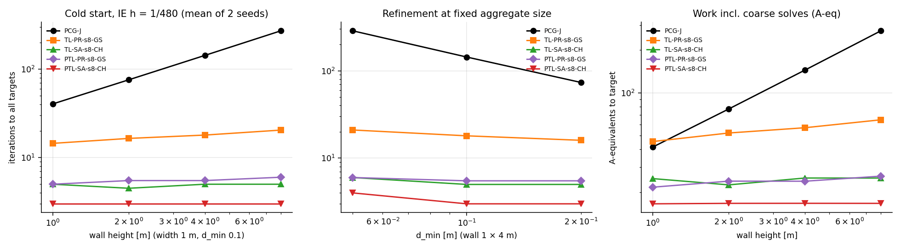
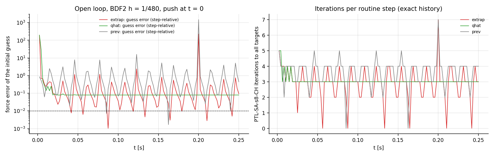
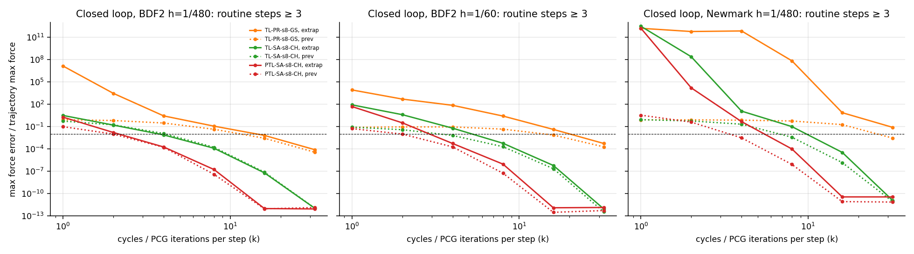
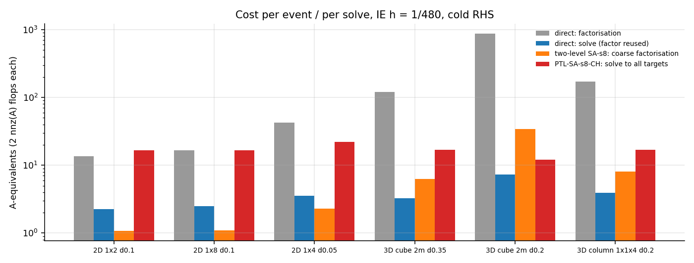

# Phase 0b / 2 — Coarse correction inside the physical step (CPU f64)

> **[rev 2026-11-07, audit by the project lead; corrected series v2 in `results/phase0b/two-level-v2/`, see §8 below].** Three claims of this document were wrong:
> 1. The "bands" of §5.4 did not cut the structure. The selection took facets whose segment crosses a line; it left **one connected component** (8–9 / 27–31 edges removed). With a true cut, old aggregates fail and strength-aware aggregation is necessary (T8 is in fact **confirmed**).
> 2. The closed-loop table of §5.6 quoted maxima over steps ≥ 11 as "routine steps ≥ 3". The correct value for PTL-SA-s8-CH, extrapolated guess, k = 2 is **1.65 %** on steps ≥ 3 and **81 %** at step 0. "2 iterations are enough" is withdrawn.
> 3. The closed loop with an event was not run (`tr.event.is_none()`).
>
> The intact-network results (§5.3) stand.

*Assignment: `shatterbird-phase0b-step2.md` §3–§6, plus four additions made by the project lead when handing it over:*
- *smoothed aggregation is pre-registered next to piecewise-rigid aggregation, not as a fallback;*
- *a GPU-friendly smoother next to coloured block Gauss–Seidel;*
- *a routine-step regime: elastic dynamic trajectory, initial guess from the integrator's extrapolation, events counted separately;*
- *a one-dispatch Track B variant, recorded in `docs/phase0b/track-b.md`.*

*§1–§4 (theory, method, pre-registration) were written before any solver variant was run. §5 onward holds results. Later edits are marked **[rev]** or "post-hoc".*

## 1. Theory

### 1.1 Problem and cycle

Linear elastic step from rest:
$$A u=b,\qquad A=\mu M+K,$$
with $\mu=0$ (statics) or $\mu=\alpha/h^2$ ($\alpha$ = 1 / 9⁄4 / 4 for IE / BDF2 / Newmark). $K$ is the at-rest RBSN stiffness: the same linearised components as in geometry-spectrum, so all methods see exactly the same matrix and the same force map $f_c=k_c\,j_c\!\cdot\!u$. $A$ is SPD when a support exists or $\mu>0$. Blocks are cells: 3 DOF in 2D, 6 in 3D; $D=\operatorname{blockdiag}(A_{ii})$.

**Two-level cycle (symmetric).**
1. Pre-smoothing: $S$ = one forward coloured block-GS sweep, or Chebyshev on $D^{-1}A$.
2. Coarse correction: $r=b-Au$, $A_ce_c=P^Tr$ solved by sparse Cholesky, $u\leftarrow u+Pe_c$.
3. Post-smoothing: $S^{*}$ = one backward sweep in reversed colour order, or the same Chebyshev polynomial.

The error propagation is
$$E=S^{*}\,(I-PA_c^{-1}P^TA)\,S,$$
which is $A$-self-adjoint, so the cycle is an SPD preconditioner whenever $S$ is $A$-non-expansive. It is used two ways: as a stationary iteration, and as the PCG preconditioner (two global reductions per iteration).

### 1.2 What decides the convergence rate

Classical two-grid theory (exact coarse solve, smoother spectrally equivalent to $D$) gives
$$\|E\|_A^2=1-1/K,\qquad K\simeq\sup_v\min_z\frac{\|v-Pz\|_D^2}{\|v\|_A^2}.$$

**Piecewise-rigid coarse space.** Columns are the 3 / 6 rigid motions of each aggregate. On a compact aggregate of diameter $H$, a Korn–Poincaré inequality bounds the distance to the nearest rigid motion: $\|v-\text{rigid}\|_{L^2}\lesssim H\,\|\varepsilon(v)\|$. Since $D\sim E/\ell^2$ in mass-free units, this gives $K\sim(H/\ell)^2$.
- $K$ depends on the aggregate size $s$, not on the number of cells or on slenderness $L/W$.
- The slender, fourth-order bending behaviour that made one-level methods scale as $H^4$ in E3 lives in the smooth, near-rigid-per-aggregate modes. Those are exactly the modes the coarse space represents; the exact coarse solve absorbs their bad conditioning.
- Expectation: the cycle count does not grow with wall height or with refinement at fixed $s$; only the coarse problem grows.

**Micro-rotations.** A rigid aggregate field sets all $\theta_i=\omega_a$. The local deviation $\theta_i-\omega$ is penalised by the facet tangential and rotational springs, so it is a high-energy component that the smoother removes.

**Smoothed aggregation (SA).** $P_{SA}=(I-\omega D^{-1}A)P_{PR}$ with $\omega=4/(3\hat\lambda)$, $\hat\lambda\approx\lambda_{\max}(D^{-1}A)$. Rigid motions of the whole body stay in $\operatorname{range}(P)$ wherever $Ar=0$. SA lowers the energy of the coarse basis functions, so $K$ should fall at the price of a denser $A_c$ (aggregates couple over two rings).

**Certified smoother interval.** The splitting argument of geometry-spectrum, applied to $A=\mu M+\sum_ck_cj_cj_c^T$ with $t_c=1$, gives $A\preceq2D$, hence $\lambda_{\max}(D^{-1}A)\le2$ exactly. Damped Jacobi with $\omega<1$ and Chebyshev with upper interval end $\ge\lambda_{\max}$ are therefore non-expansive without any eigenvalue estimate. A Lanczos estimate only tightens the interval.

### 1.3 Inertia does not help at game step sizes

For $\mu=\alpha/h^2$, $K$-modes with stiffness below $\mu m$ are mass-dominated, i.e. wavelengths longer than the screening length $\sim c\,h$.
- 0.1 m cells: $c\,h$ = 7.4 m at $h$ = 1/480 and 59 m at 1/60, both longer than the structures here. The dynamic operators are then essentially as hard as statics: $\pi_h=(ch/\ell)^2\approx5\cdot10^3$ and $3.5\cdot10^5$.
- The mass term removes the singularity of free fragments.
- The coarse space becomes unnecessary only for $ch\lesssim\ell$, the explicit regime.

### 1.4 Weakened bands

If a band of facets is scaled by $\eta$, the rigid motions of the part above the band acquire energy $\propto\eta$.
- If an aggregate straddles the band, $Pz$ cannot move only its upper cells: $\min_z\|v-Pz\|_D=O(\|v\|_D)$ while $\|v\|_A^2=O(\eta)$, so $K\sim1/\eta$ for $\mu=0$. For $\mu>0$, $K$ is capped near $D/(\mu m)\sim\pi_h$. Iterations should blow up as $\eta\to0$ with old aggregates.
- Strength-aware aggregates never straddle a weak band. Fragment rigid motions are then in $\operatorname{range}(P)$ and $K$ stays bounded independently of $\eta$.

**Update cost** after a change of $\eta$:
- P unchanged: re-assemble $A_c$ and refactor it numerically (symbolic analysis reused).
- Strength-aware: aggregation, P, $A_c$, symbolic and numeric factorisation.

### 1.5 Routine steps

The integrator's extrapolation gives the initial guess, so the initial error is the predictor error.
- For a mode of frequency ω, quadratic extrapolation ($3u_n-3u_{n-1}+u_{n-2}$) has relative error $\sim(\omega h)^3$; the Newmark predictor $u_n+hv_n+\tfrac{h^2}2a_n$ has $\sim(\omega h)^3/6$.
- Quadratic extrapolation amplifies a sign-alternating component by 7. High-frequency content left by a localized push can make it worse than lower-order guesses, which is why the integrator target $\hat q$ is also tested.
- A contraction factor $\rho$ per cycle then needs $\lceil\log(\mathrm{tol}/e_0)/\log\rho\rceil$ cycles, possibly 0–2 at $h$ = 1/480.
- At $h$ = 1/60 a 36 Hz mode has $\omega h=3.8$: the predictor is roughly as bad as a cold start.
- In closed loop (fixed $k$ cycles per step), per-step solver errors enter the zero-stable integrator and accumulate at most linearly. That has to be measured, not assumed.

## 2. Method

**Reference.**
- Sparse Cholesky of $A$ (faer). Scaled residual $\|b-Au\|_\infty/(\|A\|_\infty\|u\|_\infty+\|b\|_\infty)$.
- For $n\le1500$, also compared with a dense partial-pivot LU solve, an independent algorithm.

**Methods** (same $A$, same $b$, same initial guess):

| id | description | per iteration / cycle |
|---|---|---|
| `GS1` | stationary coloured block GS (forward sweeps); cap 1024 | 1 A-equivalent, $n_{\rm col}$ phases |
| `PCG-J` | PCG with block-Jacobi; cap 1024 | 1 A-application, 1 block solve, 2 reductions |
| `TL-{PR,SA}-{s8,s16}-{GS,CH}` | two-level stationary cycle; cap 32 | GS: fwd sweep, residual, coarse, bwd sweep; CH: Chebyshev pre, residual, coarse, Chebyshev post |
| `PTL-…` | PCG preconditioned by the same cycle (from zero); cap 32 | + 1 A-application, 2 reductions |

**Coloured block GS.** Greedy colouring of the cell graph in cell-ID order. Within a colour, blocks are independent. A block update uses the factorised $6\times6$ / $3\times3$ diagonal block.

**Chebyshev smoother (`CH`).**
- Degree 2 on $D^{-1}A$, interval $[\hat\lambda/8,\hat\lambda]$.
- $\hat\lambda$ = 1.05 × (15-step Lanczos estimate of $\lambda_{\max}(D^{-1/2}AD^{-1/2})$, deterministic start), capped at the certified bound 2.
- Pre- and post-smoothing use the same polynomial.
- This smoother has no colour phases: 2 A-applications per smoothing, each one dependent phase.

**Aggregation (deterministic).** Cell positions are centroids, IDs are RSA insertion order, $\bar\ell$ = (mean cell volume)$^{1/d}$.
1. *Seeds.* In ID order, a cell becomes a seed if its Euclidean distance to every existing seed is $\ge R$. $R=0.834\sqrt s\,\bar\ell$ (2D) or $0.899\,s^{1/3}\bar\ell$ (3D), from jamming of a greedy hard-core set: $s\approx1.436(R/\bar\ell)^2$ or $1.378(R/\bar\ell)^3$.
2. *Assignment.* Multi-source Dijkstra over **strong** edges of the facet graph, edge length = centroid distance, ties by (distance, seed ID). A component with no seed gets its lowest-ID cell as a new seed.
3. *Detour rule.* If a cell's path distance exceeds $2\times$ its Euclidean distance to the seed plus $\bar\ell$, the lowest-ID such cell becomes a new seed and step 2 is repeated.
4. *Small aggregates* ($<s/4$ cells) merge into the adjacent aggregate with the most strong edges to them (ties: lower aggregate ID).

**Strong edges.**
- *Intact aggregation:* all facets are strong.
- *Strength-aware:* a facet is strong iff its stiffness multiplier is $\ge\theta_s=0.1$, i.e. $1-d\ge0.1$ in an engine with damage. Fixed before any band test.

**Coarse space.** For aggregate $a$, the centre $x_a$ is the mass-weighted centroid.
- 2D columns: $(1,0,0)$, $(0,1,0)$ and a rotation $\big(-(y_i-y_a),\,x_i-x_a,\,1\big)/\rho_a$ on every member, with $\rho_a$ = radius of gyration of member centroids, $\ge\bar\ell/2$.
- 3D: 3 translations + 3 rotations $u_i=\omega\times(x_i-x_a)$, $\theta_i=\omega$, scaled the same way.
- $A_c=P^TAP$ (sparse products), factorised by sparse Cholesky.
- SA: $P=(I-\omega D^{-1}A)P_{PR}$ with $\omega=4/(3\hat\lambda)$ (same $\hat\lambda$), and $A_c$ from the smoothed P.

**Metrics** (after every iteration; tabulated at 0/1/2/4/8/16/32):
- **F:** relative L2 error of facet resultants, max over $N$, $V$, $M$ in 2D (each normalised by its own reference norm). In 3D, the max over the 6 component families (3 forces, 3 moments).
- **E:** $\|u-u_{\rm ref}\|_A/\|u_{\rm ref}\|_A$.
- **R:** support reaction. Force error $|R-R_{\rm ref}|/|R_{\rm ref}|$ and moment error about the base centre $|M-M_{\rm ref}|/\max(|M_{\rm ref}|,\,|R_{\rm ref}|L)$, kept separate.
- **χ (2D only):**
  - SB-IL1 onset indicator per facet point, $\chi=\sqrt{\langle\delta_n\rangle_+^2+\gamma\delta_t^2}/\delta_0$, on intact facets.
  - The reference is scaled so that $\max\chi_{\rm ref}=0.95$; the same factor is applied to the iterate. χ is positively 1-homogeneous in $u$, so this equals solving the scaled load.
  - Target: $\max|\chi-\chi_{\rm ref}|\le0.01$ over points with $\chi_{\rm ref}\ge0.8$. The maximum over all points and its location are also recorded.
  - Trajectories use one scale factor per trajectory (max over all steps = 0.95), not per step.
- Scaled residual and the location (cell) of the worst force error.
- **Iterations to target:** the first iteration at which F ≤ 1 %, E ≤ 1 %, both R parts ≤ 1 % and the χ criterion all hold. Above the cap the result is *censored* and not extrapolated.

**Work accounting.**
- **A-equivalents:** 1 per matvec or GS sweep; flops = 2 nnz(A) per A-application.
- **Sequential phases:** a GS sweep counts $n_{\rm col}$ phases; a matvec, Chebyshev step, restriction, prolongation or block-diagonal solve counts 1.
- **Global reductions:** 2 per PCG iteration.
- **Coarse solves:** forward + backward, 4 nnz($L_c$) flops.
- **Setup and update:** time, nnz(P), nnz($A_c$), nnz($L_c$), factorisation flops, memory.
- Costs are reported separately for cold start, repeated RHS with an unchanged operator, stiffness update (P kept) and rebuild after rupture (strength-aware). Numerical factorisations are never amortised across events that change the matrix.

## 3. Reliability fixes (§3 of the assignment)

1. **E7.** `S0` and `S0Event` reference steps return *invalid* when Newton fails. For `S0Event` that means failure even at the $h/256$ floor. Nothing is committed: coordinates, damage history, integrator state, time and counters. The trajectory stops with a reason.
   - A driver restarts the whole trajectory at constant $h/2$, up to $h/8$, recording every attempt. BDF2 history is never carried across a step-size change.
2. **E9.** The Newton result is checked.
   - An invalid coarse-step run is reported as invalid, not restarted: $h$ is the experiment's variable there.
   - Reference runs restart at $h/2$, up to 3 times.
3. **Partial supports and loads.** `attach_boundary_exact` / `edge_traction_exact` clip each boundary edge to the declared interval. Facet points, area, arms and weights then come from the clipped segment; $\ell_e$ is unchanged.
   - E7's prop now uses the exact version.
   - E2, E6 and `ranges.rs` keep the historical midpoint rule, so their stored results stay reproducible. E6's 3 support/pad regions are noted as affected (Phase 0 caveat).
4. **Short checks only** (`cargo run --release --bin two_level -- checks`):
   - a forced Newton failure in an E7 cantilever trajectory (`max_iter = 1`) must yield invalid with nothing committed;
   - the restart driver must succeed at a smaller $h$ when the forced failure only applies to the first attempt;
   - on 3 tessellations, exact supported length, resultant force and moment of a partial support/load must match the analytic values to 1e-12, while the midpoint rule's errors are shown.

   Old E7/E9 results are kept, and their dynamic comparison is marked preliminary.

## 4. Pre-registration (manifest: `results/phase0b/two-level/manifest.json`)

**Geometry** (contract meshes): constrained RSA from scratch with generator–support distance $\ge0.5\,d_{\min}$ on supported edges. Material: reference concrete, γ = 1, physical masses.
- **E2 block:** 1 × 0.5 m, $d_{\min}$ 0.05, $b$ 0.1, full base support, seeds 1, 2.
  - Loads: uniform top pressure 1 MPa.
  - Non-uniform load: the Phase 0 patch $(+0.5,-2)$ MPa on $x\in[0,0.4]$, applied exactly (clipped).
- **E3 walls:** width 1 m, $b$ 0.2, full base support, top traction $(2.5,-10)$ kPa on the whole top edge.
  - Heights 1 / 2 / 4 / 8 m at $d_{\min}$ 0.1.
  - Wall 1 × 4 m at $d_{\min}$ 0.2 / 0.1 / 0.05.
  - Seeds 1, 2.
- **Operators:** μ = 0; μ = 1/h² for h = 1/60 and 1/480 on all walls. On the representative wall (1 × 4 m, $d_{\min}$ 0.1, seed 1), also μ = (9/4)/h² and 4/h² for both h.
- **Right-hand sides.**
  - *Cold:* $b$ = load, $u_0=0$. For μ > 0 this is the first step from rest with the load applied suddenly.
  - *Post-event:* after the band of §4.3 weakens ($\eta=10^{-2}$), $b$ is the same load, and $u_0$ is the converged solution of the intact system with the same μ (warm start transferred without access to the new reference).

**Bands (wall 1 × 4 m, $d_{\min}$ 0.1, seeds 1, 2).**
- *Band:* all interior facets whose segment crosses the line $y=H/2$, scaled by η ∈ {1e-2, 1e-4, 0}. η = 0 only with μ > 0.
- *Fragments:* the bands at $y=H/4,H/2,3H/4$ with η = 0, giving 3 free fragments over a supported base. μ > 0 only.
- Aggregations compared: intact (old) and strength-aware ($\theta_s$ = 0.1).

**Routine dynamic steps** (wall 1 × 4 m, $d_{\min}$ 0.1, seed 1).
- Initial state: rest, zero displacement; cells with centroid $y>H-0.25$ get $v_x$ = 1 m/s (a push); no load.
- Reference trajectories by direct solves:
  - BDF2 at h = 1/480 for 0.25 s (120 steps) and h = 1/60 for 0.5 s (30 steps);
  - Newmark at h = 1/480 for 0.25 s.
  - Integrator formulas are those of `solvers::integrator` on DOF vectors (BDF2 starts with one IE step).
- Initial guesses:
  - BDF2: quadratic extrapolation $3u_n-3u_{n-1}+u_{n-2}$ (linear at step 1, $u_0+hv_0$ at step 0), and the integrator target $\hat q$;
  - Newmark: $u_n+hv_n+\tfrac{h^2}2a_n$.
- **Open loop:** every step starts from the exact history, and the same metrics are measured. Errors are also reported relative to the step increment $\|u_{\rm ref}-u_n\|_A$ (diagnostic).
- **Closed loop:** a fixed $k\in\{1,2,4\}$ stationary cycles per step from the variant's own history, for the 8 stationary two-level variants. Reported: force error and energy versus the reference trajectory over time.
- **Event inside the trajectory:** at t = 0.05 s (h = 1/480) the mid-height band weakens to η = 1e-2. Reported separately: update cost (P kept / strength-aware rebuild) and cycles at the event step.

**3D transfer** (rbsn3, constrained RSA, full bottom support, top traction (10, 0, 0) kPa, seeds 1, 2):
- cube 2 m at $d_{\min}$ 0.35 / 0.2, and block 1 × 1 × 4 m at 0.2;
- μ = 0, 1/h² at 1/60 and 1/480.
- **Chosen variant**, fixed now: the two-level variant with the fewest A-equivalents (coarse solves counted as $4\,{\rm nnz}(L_c)/(2\,{\rm nnz}(A))$ A-equivalents) to reach the targets, summed over the 2D development walls' dynamic operators. Ties go to PR, then s16, then GS.
- Other variants in 3D are supplementary.

**Held-out:** seeds 3001/3002 (unused so far), walls of height 4 / 8 m at $d_{\min}$ 0.1, all variants, no retuning.

**Caps:** one-level 1024 iterations; two-level 32 cycles or PCG iterations.

**Continuation signal (from the assignment, not a pass/fail of the hierarchy):** targets within ≤ 8 cycles on the main dynamic operators, and growth ≤ 2× from height 2 to 8 m.

**Predictions:**
- **T1.** PR two-level PCG (GS smoothing) meets all targets within ≤ 12 iterations on static walls, with growth ≤ 1.3× from height 2 to 8 m and ≤ 1.5× over refinement 0.2 → 0.05 at fixed s.
- **T2.** SA needs 1.3–2× fewer iterations than PR, at ≥ 2× nnz($A_c$).
- **T3.** Chebyshev needs 1.2–1.6× more cycles than GS, but has fewer dependent phases per cycle in 2D (≈5 vs ≈2·6 + 3).
- **T4.** One-level PCG-J iterations grow ∝ height (cap reached for none); stationary GS hits the cap from 4 m on.
- **T5.** Dynamic operators at 1/480 and 1/60 behave like statics (within 1.5× iterations).
- **T6.** Routine steps at h = 1/480: the predictor error is 1–10 %, so 1–2 cycles meet the targets. At 1/60 the predictor brings no gain over a cold start beyond about one cycle.
- **T7.** Closed loop with 1 cycle per step is stable. With 2 cycles the trajectory force error stays ≤ 1 % at 1/480.
- **T8.** Weak band, old aggregates: iterations rise sharply as η → 0, beyond the cap at η ≤ 1e-4 (μ = 0). Strength-aware: within 1.5× of intact.
- **T9.** Numeric refactorisation of $A_c$ costs less than one cycle's A-equivalents in 2D at these sizes. In 3D, factorisation flops grow ≈ $n_c^{1.5\text{–}2}$.
- **T10.** 3D: the chosen variant meets the targets within ≤ 1.5× its 2D iteration count. The colour count rises from ≈ 6 to ≈ 14.

## 5. Results

**Runs.**
- `cargo run --release --bin two_level` (≈2.5 min; the manifest is written first) → `results/phase0b/two-level/`:
  - `summary.json`: checks, every system with levels, timings, references and runs, variant scores, dynamics;
  - `runs.csv`, `dyn_open.csv`, `dyn_closed.csv`, `manifest.json`.
- Fix checks: `SB_E7_CHECK=1 cargo run --release --bin e7`, `SB_E7_NEWTON_DIAG=1 …`, `SB_E9_CHECK=1 cargo run --release --bin e9` → `results/phase0b/two-level/fix-checks/`.
- Figures: `python3 analysis/plot_two_level.py`. Source hash: 59660c6b401ca7e2.

**[rev] Changes made before the main runs, found on the E2 smoke test:**
- *Force metric.* Each family normalised by its own reference norm divides round-off by round-off under uniform load (V, M ≈ 0). N and V now share the joint force norm. M (and the 3D rotational families) use $\max(\|M\|,\|(N,V)\|\,\bar\ell/\sqrt{12})$.
- *Variant-choice rule, clarified before the 3D run.* Variants are ranked first by the number of censored systems, then by the summed A-equivalents.

**Post-hoc (after the first full run), marked as such:**
- closed loop with $k\in\{8,16,32\}$, the guesses $\hat q$ and "previous solution", and the PCG forms;
- the trajectory-normalised error measure (§5.6).

### 5.1 Reliability fixes (§3)

| check | result |
|---|---|
| E7 forced Newton failure (`max_iter = 1`), S0 and S0Event | invalid at step 0; 0 steps recorded, integrator not advanced, committed κ and $D$ unchanged — **pass** |
| E7 restart driver (attempt 1 forced to fail) | restarts from $t=0$ at constant $h/2$; returns the first valid attempt — **pass**, see below |
| E9 forced failure | invalid at outer step 0; the normal run stays valid — **pass** |
| partial support / load, 3 tessellations | exact clipping: length, force, moment errors ≤ 6e-16. Midpoint rule: supported length off by **25–38 %**, load 1.7–10 %, moment 1.3–10.5 % |

**Finding — the corrected path exposes a real reference failure.**
- The restart driver on the E7 cantilever (BDF2, $h$ = 1/480) failed genuinely at 1/960 (step 10) and at 1/1920 (step 0). It became valid only at **1/3840**.
- Diagnosis (`e7_newton_diag.json`): a **clamp support facet with generator–support distance $d=0.047\,d_{\min}$**, the plain-RSA defect of geometry-spectrum.
  - Its onset opening $\delta_0=\sigma_td/E$ is about 20× smaller than normal while its stiffness $EA/d$ is huge.
  - The first Newton iterate jumps it to $d\approx0.7$. Newton then cycles between two branches (residual 6.1e5 ↔ 9.4e5), although the propped static state has $\max\chi=0.15$.
- The old E7 S0 runs accepted 1–3 such failures (`newton_failures` in `results/E7/summary.json`). **Their dynamic comparison is preliminary, as the assignment says.** A new E7 reference needs the contract mesh and a decision on damageable support facets (the SB-IL1 limitation already named in E6).

E6 also used midpoint-selected support and pad ranges (Phase 0 caveat). E2, E6 and `ranges.rs` keep the historical rule for reproducibility.

### 5.2 Implementation checks (§5.1.1)

On a block 1 × 0.5 m, $d_{\min}$ 0.1, static and IE 1/480:
- **Matrix:** $A$ symmetric to 6e-17. Reference scaled residual ≤ 4.5e-16 in every system. Dense LU agreement ≤ 5e-12 (all $n\le1500$). Static support reaction equals the applied load to 1.2e-15.
- **Coarse spaces:** coarse energy identity ≤ 8e-16. An error in range(P) is removed by one coarse correction to ≤ 1.3e-15. $P^TMP$ full rank (condition 1.8–7).
- **Global rigid motions:** reproduced exactly by PR (≤ 1e-16). With SA they are not: **11–14 %** M-norm misfit in this small, support-dominated block. That is expected — SA keeps a rigid motion only where $Ar=0$, i.e. not at support cells or with $\mu>0$.
- **Cycle as preconditioner:** symmetric to ≤ 1.4e-15 and positive, for both smoothers and both P.
- **Smoother interval:** $\hat\lambda(D^{-1}A)$ = 1.87–1.92 (certified bound 2).

### 5.3 Cold start: slenderness, refinement, operators

Iterations to **all** targets (F, E, R, χ), IE $h$ = 1/480, cold RHS, two seeds each. Static and $h$ = 1/60 differ by ≤ 1 iteration.

| wall | cells | GS1 | PCG-J | TL-PR-s8-GS | TL-SA-s8-CH | PTL-PR-s8-GS | PTL-SA-s8-GS | **PTL-SA-s8-CH** |
|---|---|---|---|---|---|---|---|---|
| 1 × 1, $d_{\min}$ 0.1 | 75 | 974–1002 | 40–41 | 14–15 | 5 | 5 | 4 | **3** |
| 1 × 2, $d_{\min}$ 0.1 | 146 | >1024 | 76 | 14–19 | 4–5 | 5 | 4 | **3** |
| 1 × 4, $d_{\min}$ 0.1 | 283 | >1024 | 143–144 | 16–20 | 5 | 5–6 | 4 | **3** |
| 1 × 8, $d_{\min}$ 0.1 | 568 | >1024 | 269–276 | 20–21 | 4–6 | 6 | 3–5 | **3** |
| 1 × 4, $d_{\min}$ 0.2 | ≈ 75 | >1024 | 72–75 | 15–17 | 5 | 5–6 | 3–4 | **3** |
| 1 × 4, $d_{\min}$ 0.05 | 1 099 | >1024 | 286–287 | 21 | 6 | 6 | 4–5 | **4** |

- **Slenderness is removed from the solve.** Height 2 → 8 m: PCG-J ×3.7 (77 → 286), PTL-SA-s8-CH ×1.08 (3.0 → 3.25), TL-SA-s8-CH ×1.05, PTL-PR-s8-GS ×1.19.
  - In A-equivalents to target: 16.7 → 18.0 (PTL-SA-s8-CH) against 78 → 287 (PCG-J).
  - Refinement 0.2 → 0.05 at fixed $s$: +0–1 iteration.
  - The cubic one-level growth of E3 ($H^4$ sweeps) does not appear.
- **Dynamic operators behave like statics.** IE, BDF2 and Newmark at 1/60 and 1/480 on the representative wall give 3–4 PTL-SA-s8-CH iterations and 134–151 PCG-J, as predicted from $ch\gg L$.
- **Variant ranking.** Summed A-equivalents over the 28 development systems (no variant censored except stationary PR):

  | variant | Σ A-eq | median per system |
  |---|---|---|
  | **PTL-SA-s8-CH** (chosen) | 493 | 16.6 A-eq, 37 phases, 3 coarse solves, 6 reductions |
  | PTL-SA-s8-GS | 509 | 17.9, 69 phases |
  | TL-SA-s8-CH | 713 | 25, 59 phases, no reductions |
  | PTL-PR-s8-GS | 676 | 25.7 |
  | TL-PR-s8-GS | 1 540 | — |
  | PCG-J | — | 111 |

  - SA beats PR by 1.5–2× in iterations.
  - Chebyshev needs no more cycles than GS (fewer, in fact) and **half the dependent phases**.
  - $s$ = 8 beats 16. The realised mean aggregate size was 8.0 / 12.6 cells against the targets 8 / 16: the seed-density calibration undershoots for $s$ = 16.
- **Binding criterion.** Among two-level runs, χ (onset indicator near failure) is the last target met (alone or jointly) in 229 of 379 cases; the energy norm or the reaction in most of the rest. The local near-failure accuracy is the hardest target, as the assignment anticipated.

### 5.4 Events, weakened bands, fragments

**Post-event** (mid-height band η = 1e-2, warm start from the intact solution):
- PTL-SA-s8-CH 2–4 iterations, both with "P kept" ($A_c$ re-assembled and refactored) and with the strength-aware rebuild.
- The rebuild helps stationary cycles (TL-SA-s8-CH 5 → 2 on seed 2; 17–18 → 5 on held-out 1 × 8, s3001), and PCG by ≤ 1 iteration.

**Bands (wall 1 × 4, $d_{\min}$ 0.1):**

| case (IE 1/480, s1) | PCG-J | TL-SA-s8-CH old → strength-aware | PTL-SA-s8-CH old → strength-aware |
|---|---|---|---|
| 1 band, η = 1e-2 / 1e-4 / 0 | 143 | 5 → 5 | 3 → 3 |
| 3 bands, η = 0 (3 free fragments) | 165 | **25 → 11** | 6 → 5 |
| same, IE 1/60 | 173 | **28 → 8** | 6 → 5 |

- **[rev 2026-11-07: WRONG — the band was not a cut; see §8.]** ~~Prediction T8 is refuted for a single band.~~ The iteration counts do not depend on η or on the aggregation. The cut is real (8 facets, full width), and the aggregates do differ (max detour 0.82 vs 1.2). Two mechanisms explain it:
  - (i) The forces near the base, where the binding χ and reaction targets live, are statically determined by the load and do not see the band.
  - (ii) The near-null rigid modes of the part above the band are isolated eigenvalues; PCG removes them in about one iteration each, and the smoother fixes the few straddling cells.
- The $1/\eta$ blow-up of the two-grid constant is a worst-case bound that the metrics never meet here.
- With several cuts, strength-aware aggregation matters: stationary cycles 2.3–3.5× fewer, PCG 1 iteration fewer.

**Update cost per event (CPU, μs):**

| geometry | variant | cycle (CH) | $A_c$ + numeric refactor | full strength-aware rebuild |
|---|---|---|---|---|
| 2D 1 × 8 (568 cells) | PR s8 | 157 | 287 | ≈ 520 |
| 2D 1 × 8 (568 cells) | SA s8 | 155 | 784 | ≈ 1 960 |
| 3D cube $d_{\min}$ 0.2 (688 cells) | PR s8 | 1 247 | 3 530 | ≈ 3 900 |
| 3D cube $d_{\min}$ 0.2 (688 cells) | SA s8 | 1 415 | **27 233** | ≈ 37 800 |

SA's coarse operator $P^TAP$ is 3× denser than PR's in 3D (98 k vs 31 k nnz). Its assembly with this generic sparse product dominates: about 20 cycles per stiffness change in 3D, against about 3 for PR. **SA wins per solve and loses per event.** At about 2 iterations saved per step (≈ 2.4 ms) against ≈ 24 ms extra per event, the break-even is roughly one event every 10 steps.

### 5.5 Routine steps: open loop (exact history)

Push of the 1 × 4 wall; steps ≥ 3. Iterations of PTL-SA-s8-CH to all targets (step-relative, as §5.2 of the assignment demands):

| trajectory | guess | guess force error (median, step-rel. / traj.-norm.) | PTL-SA-s8-CH median / p90 / max | TL-SA-s8-CH median | PCG-J median |
|---|---|---|---|---|---|
| BDF2 1/480 | extrapolation $3u_n-3u_{n-1}+u_{n-2}$ | 7.4 % / 3.1 % | 3 / 4 / 7 | 4 | 56 |
| BDF2 1/480 | $\hat q$ | 8.0 % / 3.7 % | 3 / 3 / 4 | 4 | 56 |
| BDF2 1/480 | previous solution (post-hoc) | 38 % / 17 % | 4 / 4 / 7 | 6 | 87 |
| BDF2 1/60 | extrapolation | 760 % / 0.06 % | 5 / 5 / 5 | 10 | 147 |
| BDF2 1/60 | previous solution | 320 % / 0.01 % | 4 / 5 / 5 | 9 | 134 |
| Newmark 1/480 | Newmark predictor | **3.5·10⁵ %** | 6 / 7 / 7 | 10 | 163 |
| Newmark 1/480 | previous solution | 130 % | 4 / 4 / 5 | 5 | 117 |

- **The hypothesis "1–2 cycles in routine steps" does not hold at the 1 % step-relative standard.** At 1/480 the integrator's guess is already within 3–8 % (prediction T6 confirmed). One PCG iteration contracts the force error only about 3–5×, so 3 iterations are still needed: the guess saves about one iteration against a cold start (3 against 3–4).
- **At 1/60 the extrapolation is worse than the previous solution.** BDF2 has damped the motion, and the guess error is enormous relative to the tiny step state.
- **Newmark's predictor $u+hv+\tfrac{h^2}2a$ is unusable here.** The average-acceleration rule keeps the stiff modes' accelerations, which a localised push excites, undamped, and the predictor extrapolates them.

### 5.6 Routine steps: closed loop (own history) — the decisive result

A fixed $k$ cycles or PCG iterations per step, from the variant's own history. The table gives the maximum force error over routine steps ≥ 3, normalised by the trajectory's maximum force (post-hoc measure: step-relative errors explode where a step's own forces are near zero).

| trajectory | variant, guess | k = 1 | 2 | 4 | 8 |
|---|---|---|---|---|---|
| BDF2 1/480 | TL-PR-s8-GS, extrapolation | **1.4·10⁷ (diverges)** | 3·10³ (diverges) | 0.53 | 0.10 |
| BDF2 1/480 | TL-SA-s8-CH, extrapolation | 1.06 | 0.037 | 1.6·10⁻³ | 2.8·10⁻⁵ |
| BDF2 1/480 | PTL-SA-s8-CH, extrapolation | 0.31 | **9.3·10⁻³** | 1.0·10⁻⁴ | 1.7·10⁻⁸ |
| BDF2 1/480 | PTL-SA-s8-CH, previous solution | 0.10 | 9.9·10⁻³ | 1.6·10⁻⁴ | 5.7·10⁻⁸ |
| BDF2 1/60 | PTL-SA-s8-CH, extrapolation | 7.0 | 8·10⁻⁴ | 5.8·10⁻⁶ | — |
| Newmark 1/480 | PTL-SA-s8-CH, Newmark predictor | 1.7·10¹² (diverges) | 1.7·10⁴ (diverges) | 0.48 | 9·10⁻⁵ |
| Newmark 1/480 | PTL-SA-s8-CH, previous solution | 3.5 | 0.41 | 3.2·10⁻³ | 2·10⁻⁶ |

- **An inexact solve inside the integrator can be unstable.** With polynomial extrapolation, the guess error contains $3e_n-3e_{n-1}+e_{n-2}$ of the past solve errors (amplification up to 7 for sign-alternating components). The loop is stable only if the per-step contraction beats this.
  - Stationary PR with GS (ρ ≈ 0.8 per cycle) diverges at k ≤ 2. This is the same instability class as budgeted S1 in E7, now explained.
  - At k = 32 every variant reproduces the reference to ≤ 4·10⁻⁹, so there is no implementation error.
- **[rev 2026-11-07: misquoted, see §8.]** ~~BDF2 + PTL-SA-s8-CH: 2 iterations per step keep routine-step forces at ≈ 1 % of the trajectory scale~~ (the 0.93 % was the maximum over steps ≥ 11; steps ≥ 3 give 1.65 %, step 0 gives 81 %). That is the routine cost: ≈ 11–12 A-equivalents, ≈ 25 phases, 2 coarse solves and 4 reductions per step.
- **Newmark** (no numerical damping) does not damp solver errors; even with the safer previous-solution guess, 4 iterations are needed. Together with E8 (implicit Euler too dissipative), the integrator and the inexact solve have to be chosen together.
- **The push itself is an event.** The first step needs k ≥ 4–8 with the extrapolated guess, because $u_0+hv_0$ creates a fictitious displacement jump.

### 5.7 Held-out seeds and 3D transfer

**Held-out** (seeds 3001 / 3002, heights 4 / 8 m, no retuning): PTL-SA-s8-CH 3–4 (cold), 2–4 (post-event); TL-SA-s8-CH 4–7; PCG-J 144–299. Same picture as development.

**3D** (rbsn3, constrained RSA, lateral top load; chosen variant fixed beforehand):

| block | cells | colours | PCG-J | **PTL-SA-s8-CH** | TL-SA-s8-CH | PTL-PR-s8-GS |
|---|---|---|---|---|---|---|
| cube 2 m, $d_{\min}$ 0.35 | 145–147 | 8–9 | 22–25 | **3** | 3–4 | 4–5 |
| cube 2 m, $d_{\min}$ 0.2 | 688–699 | 10–11 | 36–37 | **2** | 3 | 4–5 |
| column 1 × 1 × 4, $d_{\min}$ 0.2 | 385–404 | 9–10 | 105–112 | **3** | 3–5 | 6–7 |

The advantage transfers to 6-DOF blocks (prediction T10 confirmed: fewer iterations than 2D, 8–11 colours).

**Where 3D gets expensive: the coarse level and the direct competitor.** In A-equivalents per event / per solve:

| system | direct factorisation | direct solve (factor reused) | SA-s8 coarse factorisation | PTL-SA-s8-CH solve |
|---|---|---|---|---|
| 2D 1 × 8 (568 cells) | 16.6 | 2.5 | 1.1 | 16.7 |
| 2D 1 × 4, $d_{\min}$ 0.05 (1 099) | 42.6 | 3.6 | 2.3 | 22.2 |
| 3D cube $d_{\min}$ 0.35 (145) | 121 | 3.3 | 6.3 | 16.9 |
| 3D cube $d_{\min}$ 0.2 (688) | **870–1 033** | 7.3–7.9 | **31–34** | 12.1 |
| 3D column (385) | 173 | 3.9 | 8.1 | 17.0 |

- **The direct solver remains a strong competitor at these sizes.** With an unchanged operator, a reused factor solves for 2.5–8 A-equivalents (flops), against 12–22 for the two-level PCG. Its costs lie elsewhere:
  - refactorisation after every stiffness change (17–1 000 A-eq, growing with 3D size);
  - the sequential depth of the triangular solves on a GPU, not measured here.
- **The two-level coarse level is not small in 3D.** $n_c/n$ ≈ 11 % (6 DOF per aggregate of 8 cells). The SA coarse factor grows from 6 to 34 A-eq for 145 → 688 cells: flops ∝ $n_c^{2.7}$ on these small, dense-ish coarse matrices. At $10^5$ cells ($n_c$ ≈ 75 k), a direct coarse solve would dominate.

## 6. Answers (§5.3)

1. **Did the work for accurate forces fall for long/thin structures and under refinement?**
   - Yes, decisively. Two-level PCG with SA aggregation and Chebyshev smoothing reaches F, E, R and χ in 3–4 iterations (≈ 17 A-equivalents) for heights 1–8 m and $d_{\min}$ 0.2–0.05, with growth ≤ 1.08× from 2 to 8 m. One-level PCG grows ∝ height (×3.7) and ∝ $1/d_{\min}$; stationary block-GS exceeds 1 024.
   - The assignment's continuation signal (≤ 8 cycles on the main dynamic operators, growth ≤ 2×) is met by all SA variants and by PCG-PR. Stationary PR misses it (14–26 cycles).
2. **What remains expensive?**
   - In 3D, the coarse level: size (11 % of the DOFs), factorisation (31–34 A-eq at 688 cells, superlinear growth) and the SA triple product per stiffness change (≈ 20 cycles of CPU time).
   - In routine steps, the 1 % step-relative target: the predictor saves only about one iteration.
   - The χ target near failure is the binding one.
   - Smoothing and transfers are cheap; Chebyshev halves the dependent phases at equal A-equivalents.
3. **Robust to weakened bonds, seeds, 3D?**
   - Yes for seeds (held-out identical) and 3D (2–3 iterations).
   - Weakened bands do not hurt PCG with any aggregation. Multiple fragments need strength-aware aggregation for stationary cycles.
   - In a closed loop, stationary PR with GS is **unstable** at ≤ 2 cycles per step and Newmark at ≤ 2 iterations. Robustness of the inexact step depends on the integrator and the predictor, not only on the solver.
4. **Are two levels enough?**
   - In the tested range (≤ 1 100 cells 2D, ≤ 700 cells 3D), yes.
   - For 3D game scenes of $10^4$–$10^5$ cells, the coarse problem must itself be solved hierarchically (a third level, or PR at a larger $s$), not by direct factorisation. Measuring that growth is the next solver experiment.
   - Enriching P is not needed: SA already gives 2–3 iterations.
5. **Work to carry into Track B (no architecture choice yet):**
   - **Per routine step (BDF2, closed loop, ≈ 1 % of the trajectory force scale):** 2 PTL-SA-s8-CH iterations ≈ 11–12 A-applications-equivalent; ≈ 25 dependent phases (matvec, 2× Chebyshev(2), residual, restriction, coarse solve, prolongation); 2 coarse solves ($n_c$ ≈ 11 % of $n$); 4 global reductions.
   - **Per event:** $A_c$ update + numeric refactorisation; PR ≈ 3, SA ≈ 20 cycle-equivalents on CPU in 3D.
   - **Per frame** at $h$ = 1/480: 8 steps ≈ 200 phases + 16 coarse solves + 32 reductions. Compare the explicit path: 250–700 substeps of 1–2 dispatches.
   - At $h$ = 1/60, one step (≈ 25–40 phases) suffices algebraically, but BDF2 at 1/60 is known to be too dissipative for fracture (E8). The comparison at equal error belongs to §8, not to this table.

## 7. Status of the predictions

| | prediction | outcome |
|---|---|---|
| T1 | PR PCG ≤ 12 iterations, growth ≤ 1.3× (height) / 1.5× (refinement) | **confirmed** (5–7; 1.19×; +1) |
| T2 | SA 1.3–2× fewer iterations, ≥ 2× nnz($A_c$) | confirmed (1.5–2×); nnz 1.4–1.6× in 2D, 2.4–3.1× in 3D |
| T3 | Chebyshev 1.2–1.6× more cycles than GS, fewer phases | **refuted on cycles** (CH needs fewer); confirmed on phases (≈ half) |
| T4 | PCG-J ∝ height; GS hits the cap from 4 m | confirmed (×7 from 1 to 8 m); GS capped already from 1–2 m |
| T5 | dynamic operators like statics | confirmed (≤ 1 iteration difference) |
| T6 | predictor error 1–10 % at 1/480 → 1–2 cycles; no gain at 1/60 | error confirmed (3–8 %); **cycles refuted** (3 PCG iterations for 1 % step-relative); 1/60 confirmed |
| T7 | closed loop stable with 1 cycle; 2 cycles ≤ 1 % at 1/480 | **refuted for stationary PR** (divergent) and Newmark; PCG-SA with 2 iterations ≈ 0.9 % |
| T8 | old aggregates blow up as η → 0 | **refuted for one band**; moderate effect for 3 fragments (stationary 2–3.5×) |
| T9 | coarse refactorisation < 1 cycle in 2D; 3D flops ∝ $n_c^{1.5\text{–}2}$ | 2D flops yes (0.5–2.3 A-eq), but CPU update incl. $A_c$ = 2–5 cycles; 3D growth $n_c^{2.7}$ |
| T10 | 3D within 1.5× of 2D, ≈ 14 colours | confirmed (2–3 iterations; 8–11 colours) |

## 8. Audit and corrected series (Phase 0b / 3 §1, 2026-11-07)

**Changes in v2.** Run `cargo run --release --bin two_level` (now writing `results/phase0b/two-level-v2/`; v1 untouched).
- **True cut.** Each cell's layer is set by its centroid height (a tie goes up); every facet between different layers is removed.
- **Certified Chebyshev interval** [0.25, 2] instead of $\min(1.05\,\hat\lambda,2)$.
- **Work counters complete.** Every norm and inner product is a reduction and a phase. Vector passes are counted. Fixed-k PCG no longer applies a preconditioner after its last iteration.
- **Closed loop.** Every step counted, with a true-cut trajectory, local χ on the union set, and false/missed threshold crossings.

**Cut audit** (wall 1 × 4, $d_{\min}$ 0.1), identical to the independent check:

| seed | v1 one band: removed / components | v1 three bands | true cut, one plane: removed / components (sizes) | three planes |
|---|---|---|---|---|
| 1 | 8 / **1** | 31 / **1** | 17 / 2 (143 free, 142 supported) | 52 / 4 (72, 74, 71 free; 68 supported) |
| 2 | 9 / **1** | 27 / **1** | 17 / 2 (143 free, 141 supported) | 50 / 4 (68, 75, 70 free; 71 supported) |

Rigid motions of every free part are null vectors of $K$ to ≤ 2.6e-16.

**Cut series, iterations to all targets (cold).**

| case (seed 1 / seed 2) | old aggregates PTL-SA-s8-CH | strength-aware PTL-SA-s8-CH | old aggregates, stationary TL-SA-s8-CH | strength-aware TL-SA-s8-CH | PCG-J |
|---|---|---|---|---|---|
| cut η = 1e-2, IE 1/480 | 9 / 7 | 3 / 3 | >32 / >32 | 5 / 5 | 149 / 168 |
| cut η = 1e-4, IE 1/480 | 13 / 14 | 4 / 3 | >32 | 5 / 5 | 163 |
| cut η = 0, IE 1/480 | 16 / 16 | 3 / 3 | >32 | 4 / 5 | 99 / 96 |
| cut η = 0, IE 1/60 | 21 / 22 | 3 / 3 | >32 | 4 / 5 | 129 / 127 |
| 3 cuts η = 0, IE 1/480 | **>32 / >32** | 3 / 3 | >32 | 3 / 4 | 68 / 71 |
| cut η = 1e-4, static | 18 / 18 | 4 / 4 | >32 | 6 / 5 | 221 |

- Post-event (true cut, η = 1e-2, warm start): P kept 7–11, strength-aware rebuild 2–3.
- **The coarse space must not straddle a (near-)separation.** Iterations with old aggregates grow as η → 0 and diverge past the cap for several free parts, as the two-grid theory of §1.4 predicts. The v1 conclusion is withdrawn.
- Cold-start results on intact walls are unchanged under the certified interval: PTL-SA-s8-CH 3–4 iterations. Work per solve to target now counts everything: median 16.6 A-eq, **43 phases, 6 reductions**.

**Closed loop, corrected** (wall 1 × 4, push; every step counted).
- **Pass criterion:** max over **all** steps of trajectory-normalised force error ≤ 1 %, max χ error on the union set ≤ 0.01, and no false or missed crossings of 0.8. The table gives the smallest fixed k that passes, with dependent phases and reductions per step.
- **Source:** `results/phase0b/two-level-v2/summary.json` → dynamics → closed_loop.

| trajectory | coarse policy | PTL-SA-s8-CH, previous solution | PTL-SA-s8-CH, extrapolation | PTL-PR-s8-GS, previous | TL-SA-s8-CH (stationary), previous |
|---|---|---|---|---|---|
| BDF2 1/480 | — | **k = 3** (43 ph, 6 red) | k = 6 (85, 12) | k = 6 (115, 12) | k = 8 |
| BDF2 1/60 | — | **k = 3** | k = 6 | k = 6 | k = 8 |
| Newmark 1/480 | — | k = 4 (57, 8) | k = 6 | k = 8 | k = 8 |
| BDF2 1/480, true cut at 0.05 s | strength-aware rebuild | **k = 3** | k = 6 | k = 6 | k = 4 |
| BDF2 1/480, true cut at 0.05 s | P kept | **none ≤ 8** (routine-step error 15–65 %) | none | none | none |

- PTL-SA-s8-CH, extrapolation, k = 2 at BDF2 1/480: step 0 **86 %**, steps ≥ 3 **1.74 %**, χ error 1.6, 38 false crossings — fails. Previous solution, k = 2: 1.3 % over all steps.
- **The minimal passing fixed budget is 3 PCG iterations with the previous solution as the initial guess, plus a strength-aware rebuild at every separation event.** That is 43 phases and 6 global reductions per step. The extrapolated guess is worse in closed loop (k = 6), so prediction is not the cheap path here.
- The result covers linear elastic motion and a true algebraic separation. Fracture dynamics with SB-IL1 (history, softening, events) is §4 of Phase 0b / 3.
